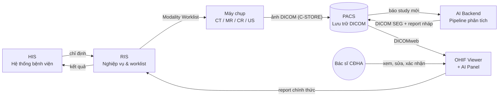
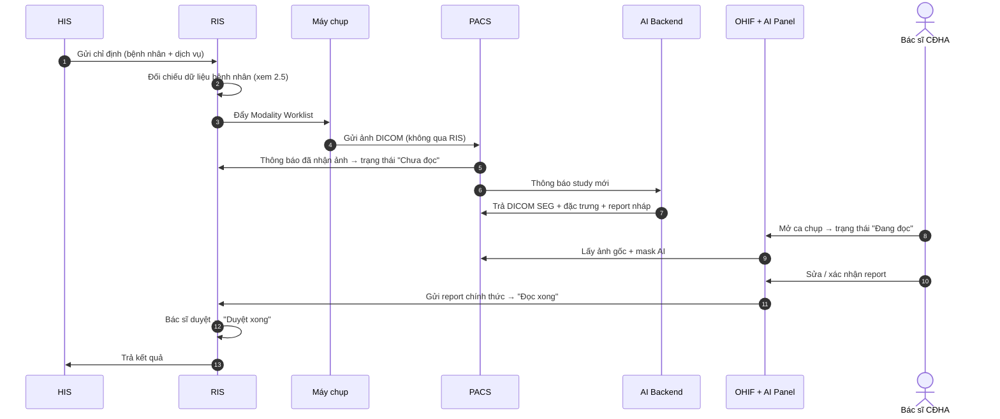
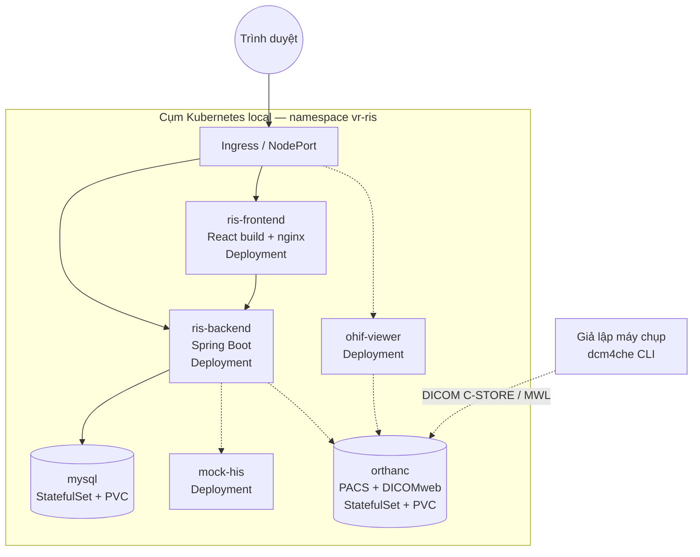
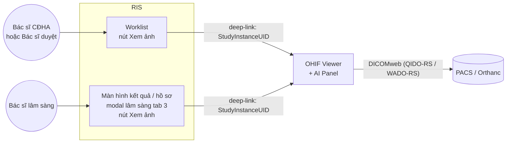
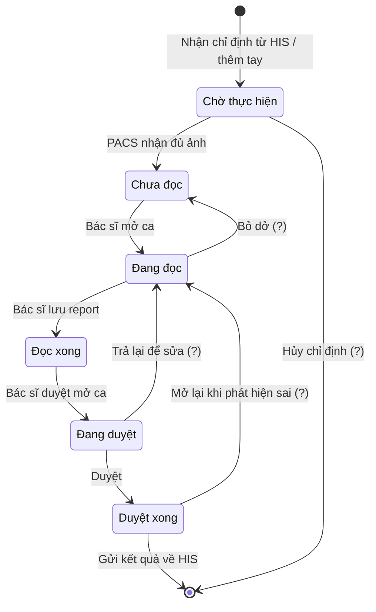
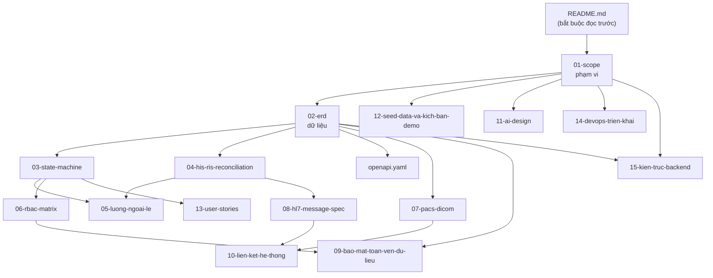
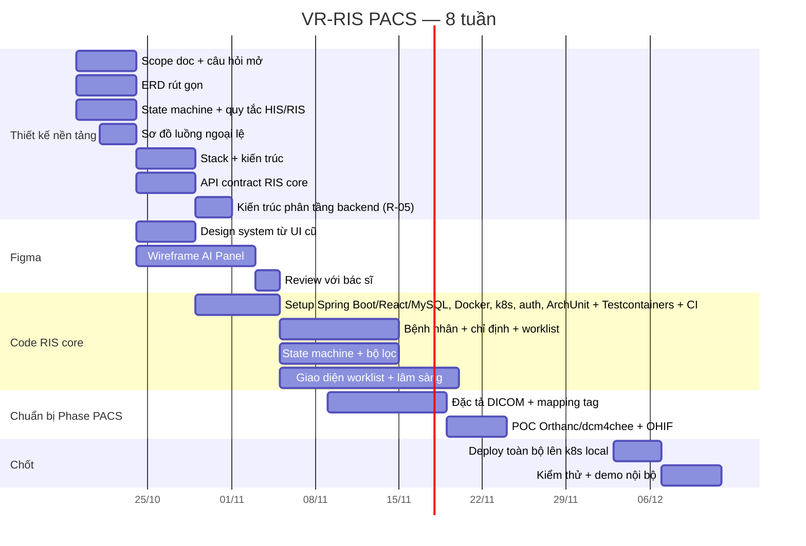

# VR-RIS PACS — Tài liệu kế hoạch dự án
 
> **Đọc file này trước khi làm bất cứ việc gì.**
> Đây là tài liệu gốc (single source of truth) mô tả bối cảnh, kiến trúc, phạm vi và kế hoạch của dự án.
> Mọi agent/thành viên mới tham gia đều bắt đầu từ đây.
 
| | |
|---|---|
| **Tên hệ thống** | VR-RIS PACS |
| **Loại** | Hệ thống RIS tích hợp PACS + AI hỗ trợ đọc phim cho bệnh viện |
| **Bối cảnh** | **Đồ án môn học** — không triển khai lâm sàng thật |
| **Stack** | React · Java Spring Boot · MySQL · Docker + Kubernetes (local) |
| **Trạng thái** | Giai đoạn thiết kế. Frontend prototype (dữ liệu giả) đã có; **Backend: skeleton kiến trúc phân tầng (R-05) cho 3 endpoint reference-data đã có, chưa commit, chưa có patient/order/study/auth thật** — xem 7.2 và `doc/15-kien-truc-backend.md` |
| **Thời gian** | **4 tuần** (xem lịch chi tiết ở Phần 7) |
| **Mục tiêu hết 4 tuần** | RIS core chạy được với dữ liệu nhập tay + thiết kế xong (chưa code) phần tích hợp PACS |
| **Ngôn ngữ tài liệu** | Tiếng Việt |
| **Cập nhật lần cuối** | 2026-10-31 |
 
### Cấu trúc repo

```text
.
├── README.md              # file này — tài liệu gốc của dự án
├── AGENTS.md              # hướng dẫn ngắn cho agent/AI — không chép lại README, chỉ trỏ và tóm tắt
├── Backend/               # Spring Boot (Java 21/Maven), kiến trúc phân tầng R-05, 3 endpoint reference-data — CHƯA commit vào git; xem Backend/README.md, doc/15-kien-truc-backend.md
├── Frontend/              # React 19 + Vite (prototype chạy bằng dữ liệu giả); xem Frontend/README.md
├── doc/                   # tài liệu thiết kế (tất cả là bản nháp chờ nhóm xác nhận)
│   ├── 01-scope.md        #   scope doc (v0.9)
│   ├── 02-erd.md          #   ERD rút gọn (v0.9)
│   ├── 03-state-machine.md          #   đặc tả state machine (README 6A)
│   ├── 04-his-ris-reconciliation.md #   quy tắc đối chiếu HIS ↔ RIS (README 2.5)
│   ├── 05-luong-ngoai-le.md         #   sơ đồ luồng ngoại lệ (README 6E)
│   ├── 06-rbac-matrix.md            #   ma trận phân quyền RBAC (README 6A)
│   ├── 07-pacs-dicom.md             #   đặc tả tích hợp PACS/DICOM (README 6B/6C)
│   ├── 08-hl7-message-spec.md       #   đặc tả message HL7 v2 ORM/ORU, HisGateway (README 6B) — nháp v0.1
│   ├── 09-bao-mat-toan-ven-du-lieu.md  #   bảo mật & toàn vẹn dữ liệu (README 6D)
│   ├── 10-lien-ket-he-thong.md      #   danh mục liên kết hệ thống + khóa nối (README 6B) — nháp v0.1
│   ├── 11-ai-design.md              #   thiết kế AI, không code (README 6E) — nháp v0.1
│   ├── 12-seed-data-va-kich-ban-demo.md #   seed data + kịch bản demo 10 bước (README 6D/6F) — nháp v0.1
│   ├── 13-user-stories.md           #   user story theo 5 vai trò (README 6A) — nháp v0.1
│   ├── 14-devops-trien-khai.md      #   Dockerfile, manifest k8s, ConfigMap/Secret, quy ước đặt tên (README 6B) — nháp v0.1
│   ├── 15-kien-truc-backend.md      #   kiến trúc phân tầng backend R-05 (README 6B)
│   ├── api/openapi.yaml   #   API contract RIS core, nháp v0.1 (README 6B)
│   ├── diagrams/          #   nguồn Mermaid (.mmd) + ảnh xuất (.png) cùng tên
│   └── archive/           #   .docx CŨ của 01-scope/02-erd — chỉ để đối chiếu, KHÔNG cập nhật nữa; bản sống là .md ở trên
├── database/              # MySQL 8.4 + Flyway dùng chung: `cd database && docker compose up -d` (xem database/README.md)
├── process/               # theo dõi tiến độ đồ án (bảng tính nội bộ)
├── .github/workflows/     # CI: backend-ci.yml (Backend), frontend-ci.yml + build-images.yml (mới 2026-11-05) — chưa chạy thật trên GitHub, Backend/Frontend chưa commit
└── deploy/                # Dockerfile (deploy/docker/), Docker Compose đầy đủ (deploy/compose/), manifest k8s (deploy/k8s/) — xem doc/14-devops-trien-khai.md; không còn "dự kiến"
```

---
 
## 0. Hướng dẫn cho agent
 
Khi bạn được giao việc trong dự án này:
 
1. Đọc hết file này để nắm bối cảnh.
2. Xác định việc được giao nằm ở hạng mục nào của **Phần 6** và tuần nào của **Phần 7**. Hạng mục gắn nhãn **[HOÃN]** thì không làm, trừ khi người dùng yêu cầu rõ.
3. Nếu thông tin cần thiết nằm trong **Phần 9 (Câu hỏi còn mở)** mà chưa có câu trả lời → **hỏi lại người dùng, không tự giả định**. Dù là đồ án, nghiệp vụ y tế vẫn cần mô phỏng đúng.
4. Khi hoàn thành một hạng mục, cập nhật lại checkbox trong file này.
5. Thuật ngữ viết tắt xem **Phần 10 (Glossary)**.
**Nguyên tắc bất biến của dự án (không được phá vỡ nếu không có quyết định rõ ràng):**
 
- RIS **không** lưu trữ hoặc xử lý ảnh DICOM. PACS là nguồn ảnh duy nhất.
- Máy chụp gửi ảnh **thẳng vào PACS**, không đi qua RIS.
- AI **không** tự động trả kết quả chính thức. Luôn phải có bác sĩ CĐHA xác nhận (human-in-the-loop).
- Mọi hành vi đọc/sửa/duyệt dữ liệu bệnh nhân đều phải ghi audit log.
- Tích hợp dùng chuẩn mở (DICOM / HL7 / FHIR), không tự chế protocol riêng.
- **Không dùng dữ liệu bệnh nhân thật** ở bất kỳ đâu (seed data, test, ảnh demo, slide). Chỉ dùng dữ liệu giả hoặc bộ DICOM công khai đã ẩn danh. Tên bệnh nhân xuất hiện trong ảnh chụp màn hình tham chiếu **không được** đưa vào seed data.
- Ảnh chụp màn hình từ hệ thống thật, khi dùng làm tham chiếu, phải **che tên bệnh nhân, mã bệnh nhân, mã hồ sơ (LSVV) và `StudyInstanceUID`** trước khi đưa vào repo, Figma hoặc slide. Che trước khi commit/upload, không che sau.
- OHIF và Orthanc trong đồ án **không được mở công khai**: chỉ truy cập được trong cụm Kubernetes local, hoặc sau khi đã đăng nhập RIS. Không expose ra Internet, kể cả để demo.
- Stack đã chốt (Phần 8) không thay đổi nếu không có yêu cầu từ người dùng.
- **R-05 — Backend theo kiến trúc phân tầng** (package-by-layer, hướng phụ thuộc một chiều), kiểm tra tự động bằng ArchUnit; vi phạm quy tắc tầng làm build đỏ. Mỗi tính năng làm theo lát dọc (rest → service → dao → model → DB), không làm "toàn bộ entity trước, toàn bộ controller sau". Chi tiết: `doc/15-kien-truc-backend.md`.
---
 
## 1. Bối cảnh
 
Hệ thống đã có một bản web đang chạy (các màn hình worklist, bộ lọc, modal thông tin lâm sàng, form thêm/sửa ca chụp, màn hình cấu hình). Dự án hiện tại là **thiết kế lại / xây dựng hoàn chỉnh** hệ thống theo kiến trúc 4 module có tích hợp AI.
 
Nguồn tham chiếu hiện có: bộ ảnh chụp màn hình giao diện đang vận hành (worklist, filter, clinical info modal, settings, add/update study dialog).
 
### 1.1. Đây là đồ án môn học — hệ quả với thiết kế
 
| Thực tế bệnh viện | Cách xử lý trong đồ án |
|---|---|
| Có HIS thật của vendor | **Mock HIS** — service giả lập API chỉ định / nhận kết quả, chạy trong cụm k8s |
| Có máy chụp thật | **Giả lập modality** bằng công cụ DICOM dòng lệnh (ví dụ bộ dcm4che: `findscu` để lấy worklist, `storescu` để gửi ảnh) |
| Ảnh bệnh nhân thật | Bộ DICOM công khai đã ẩn danh (ví dụ The Cancer Imaging Archive) |
| Kiểm định thiết bị y tế, pháp lý | **Ngoài phạm vi** — chỉ ghi chú trong báo cáo |
| Triển khai on-premise bệnh viện | **Local bằng Docker + Kubernetes**; host lên web tính sau |
 
Mục tiêu ưu tiên: **demo chạy được end-to-end** + **tài liệu thiết kế rõ ràng** để trình bày/chấm điểm.
 
---
 
## 2. Kiến trúc tổng thể
 
### 2.1. Bốn module chính
 
| Module | Vai trò | Không làm gì |
|---|---|---|
| **RIS** | Quản lý toàn bộ luồng nghiệp vụ: bệnh nhân, chỉ định, lịch hẹn, worklist, trạng thái ca chụp, báo cáo | Không lưu trữ/xử lý ảnh DICOM |
| **PACS** | Lưu trữ và truyền tải ảnh DICOM gốc + ảnh kết quả AI (DICOM SEG). Nguồn dữ liệu ảnh duy nhất của hệ thống | Không chứa logic nghiệp vụ |
| **OHIF Viewer + AI Panel** | Giao diện xem ảnh cho bác sĩ CĐHA; hiển thị overlay mask AI và panel kết quả phân tích | Không tự sinh kết quả |
| **AI Backend** | Chạy pipeline AI: segmentation → trích đặc trưng → phân loại → sinh báo cáo nháp. Độc lập với giao diện | Không ghi trực tiếp vào RIS |
 
### 2.2. Sơ đồ kiến trúc thành phần
 

 
### 2.3. Luồng dữ liệu theo thời gian (một ca chụp)
 

 
> **Lưu ý:** bước 5 (PACS báo về RIS) và cách AI chen vào trạng thái là **giả định**, chưa chốt — xem Phần 4.
>
> **Trong 8 tuần, bước 5 làm bằng tay:** người dùng tự chuyển ca sang *Chưa đọc* sau khi đã đẩy ảnh vào PACS. Việc PACS tự báo RIS để chuyển trạng thái là **[HOÃN] H-02** (`doc/01-scope.md` mục 2 và 4). Sơ đồ trên là luồng đích, không phải luồng của bản demo tuần 8.
 
### 2.4. Ranh giới tích hợp cần chốt
 
| Kết nối | Chuẩn dự kiến | Trạng thái |
|---|---|---|
| HIS → RIS (chỉ định) | HL7 v2 ORM / FHIR ServiceRequest / API riêng của HIS | ❓ chưa chốt |
| RIS → HIS (kết quả) | HL7 v2 ORU / FHIR DiagnosticReport | ❓ chưa chốt |
| RIS → Máy chụp | DICOM Modality Worklist (C-FIND) | dự kiến |
| Máy chụp → PACS | DICOM C-STORE | dự kiến |
| PACS ↔ OHIF | DICOMweb (QIDO-RS / WADO-RS / STOW-RS) | dự kiến |
| PACS ↔ AI Backend | DICOMweb + webhook/queue thông báo study mới | dự kiến |
| OHIF → RIS | REST API nội bộ | dự kiến |
| RIS / màn hình kết quả → OHIF | Deep-link kèm `StudyInstanceUID` (xem 2.7) | làm trong 8 tuần (IN-19, IN-23) |
 
### 2.5. ⚠️ Known issue: lệch dữ liệu bệnh nhân giữa HIS và RIS
 
**Hiện tượng đã quan sát:** một bệnh nhân (tên và mã thật đã được ẩn khỏi tài liệu này, theo nguyên tắc không dùng dữ liệu bệnh nhân thật) có năm sinh **1958** trong RIS nhưng màn hình "Cập nhật chỉ định từ HIS" hiển thị **1952**, tuổi **0**. Đã xác nhận là lỗi.
 
**Vì sao nghiêm trọng:** đây là lỗi đối chiếu danh tính, không phải lỗi hiển thị. Nếu không có quy tắc rõ, hậu quả có thể là ảnh/kết quả gán nhầm bệnh nhân.
 
**Quy tắc bắt buộc phải chốt trong thiết kế (không để tùy người code):**
 
- [ ] Khóa đối chiếu chính là trường nào (mã bệnh nhân / mã BHXH / tổ hợp họ tên + ngày sinh)
- [ ] Khi HIS và RIS lệch nhau: bên nào thắng, hay chặn lại và bắt người dùng xác nhận
- [ ] Có cho sửa tay thông tin đã đồng bộ từ HIS không; nếu có thì lần đồng bộ sau có ghi đè không
- [ ] Mọi lần phát hiện lệch phải ghi log riêng để rà soát định kỳ
- [ ] Tuổi phải được **tính từ ngày sinh**, không lưu cứng (tránh lỗi "Tuổi 0")
**Yêu cầu kiểm thử:** có test case riêng cho các trường hợp lệch họ tên, lệch ngày sinh, thiếu ngày sinh, trùng mã bệnh nhân.

> Bản nháp trả lời 5 checkbox trên và danh sách test case nằm ở `doc/04-his-ris-reconciliation.md` (**nháp, chờ nhóm xác nhận** — vì vậy các checkbox vẫn để trống).
 
### 2.6. Triển khai local (Docker + Kubernetes)
 

 
- **Nét liền** = có trong 8 tuần (RIS core). **Nét đứt** = thêm dần ở tuần 7 hoặc giai đoạn sau.
- Cấu hình (DB URL, mật khẩu) qua **ConfigMap + Secret**, không hard-code trong image.
- MySQL và PACS dùng **PersistentVolumeClaim** để không mất dữ liệu khi pod khởi động lại.
- **Gợi ý (chưa chốt):** dùng **Docker Compose** cho vòng dev hằng ngày (nhanh, ít cấu hình), Kubernetes cho bản tích hợp/demo. Hai bộ cấu hình dùng chung image.
---
 
### 2.7. Hai cửa vào viewer

Một study có thể được mở từ **hai chỗ khác nhau trong RIS**:

| Cửa vào | Ai dùng | Mở từ đâu |
|---|---|---|
| (a) **Worklist RIS** | Bác sĩ CĐHA (đọc), Bác sĩ duyệt | Hàng trong worklist → nút **"Xem ảnh"** |
| (b) **Màn hình kết quả / hồ sơ bệnh nhân** | Bác sĩ lâm sàng (người chỉ định) | Modal thông tin lâm sàng, tab 3 (xem 3.3) → nút **"Xem ảnh"** theo từng dịch vụ CĐHA |



**Điểm quan trọng:**

- Cả hai cửa vào **chỉ cần `study_instance_uid`** để mở **cùng một OHIF**. Không có hai viewer, không có hai cấu hình.
- **PACS không biết ai gọi.** Nó chỉ nhận yêu cầu DICOMweb cho một study. Phân quyền "ai được xem study nào" là việc của RIS — chỗ sinh ra deep-link — chứ không phải của PACS. Hệ quả: RIS phải ghi `audit_log` hành vi mở viewer (`VIEW_IMAGE`, xem `doc/02-erd.md` mục 4.11), vì PACS không ghi được giúp.
- **Viewer lấy ảnh từ PACS server qua DICOMweb, không đọc file từ đĩa.** Không có bước nào tải ảnh về máy người dùng rồi mở bằng phần mềm khác.
- **Tên / mã / tuổi hiển thị trên ảnh là của header DICOM**, không phải của bản ghi RIS mà viewer đang mở. Header DICOM do máy chụp ghi, và máy chụp lấy các trường đó **từ dữ liệu RIS qua Modality Worklist**. Nên: **nhập sai ở RIS thì ảnh cũng sai** — và sửa lại trong RIS *không* làm đổi ảnh đã nằm trong PACS. Đây chính là known issue ở **mục 2.5** nhìn từ phía ảnh. Quy tắc xử lý khi header DICOM lệch dữ liệu RIS: xem `doc/07-pacs-dicom.md` mục 8 (❓ chưa chốt).
- Trong 8 tuần chưa có MWL (H-01), nên `study_instance_uid` được **nhập tay / seed** (`doc/01-scope.md` mục 2). Ca chưa có `study_instance_uid` thì nút "Xem ảnh" **ẩn hoặc disable**, không mở viewer rỗng (IN-23).

---
 
## 3. Chức năng đã quan sát được từ hệ thống hiện tại
 
Dùng làm baseline — bản mới **tối thiểu phải có đủ** các chức năng này.
 
### 3.1. Worklist
- Hai tab: **Chờ** / **Đã thực hiện**
- Cột: STT, trạng thái, mã bệnh nhân, họ tên, ngày sinh, tuổi, giới tính, chỉ định, thời gian chụp, thời gian bắt đầu/kết thúc, bác sĩ chỉ định, chẩn đoán, máy chụp
- Panel chi tiết bệnh nhân bên phải (thông tin hành chính, chỉ định, kỹ thuật, mô tả, chẩn đoán, kết luận, khuyến nghị, người thực hiện)
- Bảng phụ phía dưới: danh sách phiếu của cùng bệnh nhân
- Đếm số lượng theo nhóm trên tiêu đề (`DANH SÁCH MÁY - (66|3.397)`)
### 3.2. Bộ lọc
- Cây máy theo khoa → nhóm → máy (Truyền nhiễm, Cấp cứu, CĐHA, Test, Trung tâm, KYC, TDCN, Phòng khám, KSK-B9, N3…)
- Lọc theo Modality
- Tìm theo mã bệnh nhân / họ tên / mã LSVV / mã phiếu
- Khoảng thời gian: Hôm nay, Hôm qua, -3 ngày, -7 ngày, -30 ngày, Tất cả, hoặc chọn ngày tùy ý
- Loại thời gian lọc: "Thời gian thực hiện" (có dropdown — cần liệt kê đủ các lựa chọn)
- **Trạng thái ca chụp**: Chờ thực hiện, Chưa đọc, Đang đọc, Đọc xong, Đang duyệt, Duyệt xong, Tất cả (kèm số đếm từng nhóm)
- **Trạng thái đồng bộ HIS**: Tất cả / Đồng bộ HIS / Chưa đồng bộ HIS / Đã gửi kết quả / Chưa gửi kết quả
- **Trạng thái BHYT**: Vi phạm BHYT / Không vi phạm BHYT
- Loại bệnh nhân: Nội trú / Ngoại trú
- Lọc theo Bác sĩ chỉ định, Chỉ định, Bộ phận chụp, Kết luận
- Nút "Danh sách ca chụp quá hạn" (có badge số lượng)
- Tùy chỉnh cột hiển thị: Bác sĩ chỉ định, Chỉ định, Bộ phận chụp, Kết luận, Mã đoàn khám, Tên đoàn khám, Mã hồ sơ, Mã bệnh phẩm, Mã lưu trữ
### 3.3. Thông tin lâm sàng (modal 5 tab)
1. **Kết quả tổng quan khám** — chẩn đoán phiếu khám, tiền sử bản thân/gia đình, sinh hiệu (nhịp tim, nhiệt độ, huyết áp, nhịp thở, chiều cao, cân nặng), quá trình bệnh lý, quá trình khám bệnh (A-B-C-D-E-G), khoa khám, phòng khám, kết luận
2. **Kết quả xét nghiệm** — bảng: STT, số phiếu, tên xét nghiệm, trạng thái, người tạo, ngày tạo, ngày thực hiện
3. **Kết quả chẩn đoán chức năng chính** — theo từng phiếu: số phiếu, ngày chỉ định, ngày trả kết quả, mã nhóm dịch vụ, ghi chú, tên dịch vụ, kết quả, mã CĐHA
   > Mỗi dịch vụ CĐHA trong tab này có nút **"Xem ảnh"** mở OHIF cho study tương ứng — đây là cửa vào (b) ở mục 2.7. Nút ẩn/disable khi study chưa có `study_instance_uid` (IN-23 ở `doc/01-scope.md`).
4. **Đơn thuốc/vật tư trong phiếu khám** — bảng: số hồ sơ, số phiếu, số dòng, mã thuốc/vật tư, tên, thành phần chung, đơn vị tính, số lượng order
5. **Dữ liệu phẫu thuật thủ thuật**
### 3.4. Quản lý ca chụp
- **Thêm ca chụp**: mã, họ tên, tuổi, giới tính, BHXH, địa chỉ, điện thoại, bộ phận chụp, chẩn đoán ban đầu, khoa chỉ định, bác sĩ chỉ định, buồng, giường, tên chỉ định, máy chụp
- **Cập nhật ca chụp**: so sánh "Thông tin hiện tại" vs "Thông tin cập nhật" theo từng trường
- **Cập nhật chỉ định từ HIS**: tra theo mã chỉ định hoặc mã bệnh nhân → chọn chỉ định trong danh sách → cập nhật
- **Thêm chỉ định**, **Lâm sàng**, **In**
### 3.5. Cấu hình hệ thống
- Loại màn: Ngang / (dọc)
- Số màn hình: Một / nhiều
- Hành vi Double Click: mở Viewer
- Tổng hợp: Đơn / …
- Giải mã tải về: Có / Không
- Ẩn bộ lọc, Ẩn danh sách máy
- Giao diện tối: Bật / Tắt
- Thao tác hàng loạt: In toàn bộ danh sách, Duyệt toàn bộ danh sách, Thêm bệnh nhân, Tải toàn bộ danh sách, Chọn Modality
---
 
## 4. Trạng thái ca chụp (state machine)
 

 
> Các mũi tên có dấu **(?)** là **giả định**, chưa được xác nhận. Luồng chính (thẳng hàng) khớp với các trạng thái thấy trên giao diện hiện tại.
> Trạng thái "Đang duyệt" có thể chỉ tồn tại ở một số khoa — cần hỏi lại.
>
> Bản nháp đặc tả (vai trò, điều kiện chuyển, đề xuất giữ/bỏ từng mũi tên (?), thêm trạng thái `CANCELLED` ❓) nằm ở `doc/03-state-machine.md` — **nháp, chờ nhóm xác nhận**; sơ đồ nguồn ở `doc/diagrams/05-state-machine.mmd`.
 
Cần đặc tả rõ (**chưa có — xem Phần 9**):
- Ai (vai trò nào) được chuyển trạng thái nào
- Có được quay lui không (ví dụ Duyệt xong → Đang đọc khi phát hiện sai)
- Điều kiện bắt buộc để chuyển (ví dụ: phải có report mới được Đọc xong)
- Trạng thái "quá hạn" tính theo quy tắc nào
- ~~AI chen vào ở đâu trong chuỗi này~~ → **Đã có đề xuất (2026-11-05, ❓ chưa xác nhận):** AI **không** chen vào 6 trạng thái chính ở trên — không có trạng thái/chuyển nào trong sơ đồ này đổi vì AI. Thay vào đó là một **trường phụ độc lập, song song** (đề xuất `study.ai_status`, 5 giá trị: `NOT_TRIGGERED/PENDING/READY/FAILED/TIMEOUT`), do PACS kích hoạt tự động khi nhận đủ ảnh, không do RIS hay bác sĩ. Đây là **thay đổi thiết kế đáng kể, thuộc [HOÃN] H-04** (không code trong 8 tuần) — chi tiết đầy đủ, kèm sơ đồ riêng, ở `doc/11-ai-design.md` mục 0 và `doc/03-state-machine.md` mục 2.6 (đã sửa cùng đợt — bản trước có mâu thuẫn nội bộ, xem mục 13 của file AI).
---
 
## 5. Vai trò người dùng
 
| Vai trò | Mô tả | Quyền chính (dự kiến — cần chốt) |
|---|---|---|
| Bác sĩ lâm sàng | Nơi phát sinh chỉ định (phía HIS) | Xem kết quả của bệnh nhân mình chỉ định |
| KTV chụp | Thực hiện chụp | Xem worklist, cập nhật thông tin ca chụp, đánh dấu đã chụp |
| Bác sĩ CĐHA (đọc) | Đọc phim, viết report | Đọc ảnh, sửa report nháp AI, chuyển Đọc xong |
| Bác sĩ duyệt | Duyệt kết quả cuối | Duyệt/trả lại report, chuyển Duyệt xong |
| Admin | Quản trị | Cấu hình máy, người dùng, phân quyền, xem audit log |
 
---
 
## 6. Danh mục tài liệu & thiết kế

### 6.0. Mục lục tài liệu và thứ tự đọc

**Trạng thái:** 🟡 nháp, chưa nhóm xác nhận · ⬜ chưa viết · ✅ nhóm đã xác nhận (**hiện chưa file nào**)

| # | File | Nhiệm vụ | Thuộc 6… | Tuần | Trạng thái |
|---|---|---|---|---|---|
| — | `README.md` | Tài liệu gốc. Bối cảnh, kiến trúc, phạm vi, lịch, câu hỏi mở | — | T1 | 🟡 |
| — | `AGENTS.md` | Hướng dẫn ngắn cho agent/AI: thứ tự đọc, nguyên tắc bất biến, quy ước code, lệnh hay dùng, việc không được tự làm | — | T1 | 🟡 |
| 01 | `doc/01-scope.md` | Phạm vi: IN / HOÃN / OUT, kịch bản nghiệm thu, giả định, phân công | A | T1 | 🟡 v0.9 |
| 02 | `doc/02-erd.md` | Thiết kế dữ liệu: bảng, cột, quyết định 4.1–4.11, chỉ mục, migration | C | T1 | 🟡 v0.9 |
| 03 | `doc/03-state-machine.md` | Vòng đời ca chụp: trạng thái, chuyển T1–T10, ai được chuyển | A | T1 | 🟡 v0.9 |
| 04 | `doc/04-his-ris-reconciliation.md` | Quy tắc đối chiếu HIS ↔ RIS (chống gán nhầm bệnh nhân) | A + 2.5 | T1 | 🟡 v0.9 |
| 05 | `doc/05-luong-ngoai-le.md` | 4 luồng ngoại lệ: chụp lại, hủy, sai thông tin, mất kết nối HIS | E | T1 | 🟡 v0.9 |
| 06 | `doc/06-rbac-matrix.md` | Ma trận phân quyền: endpoint × vai trò, chuyển trạng thái × vai trò | A | T3 (//) | 🟡 v0.1 |
| 06b | `doc/06b-ui-permission-spec.md` | Đặc tả UI × permission theo component (file con của `06`) — tra cứu khi code Frontend | A | T30 | 🟡 v0.1 |
| 07 | `doc/07-pacs-dicom.md` | Đường ảnh: AE Title, MWL, C-STORE, deep-link, mapping DICOM tag | B + C | T4–T5 | 🟡 v0.1 |
| 08 | `doc/08-hl7-message-spec.md` | Đặc tả `ORM^O01` / `ORU^R01`, mapping HL7 ↔ RIS, `HisGateway` | B | T4–T5 | 🟡 v0.1 |
| 09 | `doc/09-bao-mat-toan-ven-du-lieu.md` | Xác thực, đặc tả audit log, toàn vẹn dữ liệu, bảo vệ secret | D | T3 | 🟡 v0.1 |
| 10 | `doc/10-lien-ket-he-thong.md` | Danh mục mọi liên kết giữa thành phần + bảng khóa nối | B | T3–T4 | 🟡 v0.1 |
| 11 | `doc/11-ai-design.md` | Thiết kế AI (không code): pipeline, human-in-the-loop, AI Panel | E | T3 → T8 | 🟡 v0.1 |
| 12 | `doc/12-seed-data-va-kich-ban-demo.md` | Dữ liệu giả theo test case + kịch bản demo 10 bước | D + F | T4 | 🟡 v0.1 |
| 13 | `doc/13-user-stories.md` | User story theo 5 vai trò, chỉ cho hạng mục IN | A | viết dần khi code | 🟡 v0.1 |
| 14 | `doc/14-devops-trien-khai.md` | Dockerfile, manifest k8s, ConfigMap/Secret, quy ước đặt tên | B | T3 | 🟡 v0.1 |
| 15 | `doc/15-kien-truc-backend.md` | Kiến trúc phân tầng backend: package-by-layer, luật ArchUnit, lát dọc mẫu, vị trí audit aspect (R-05) | B | T2 | 🟡 v0.1 |
| 16 | `doc/16-fe-viewer-entry-points.md` | Kế hoạch hai cửa vào viewer (nút "Xem ảnh", IN-23) và ranh giới với AI Panel (đã cài đặt IN-19, IN-23) | C | T6–T7 | 🟡 v0.2 |
| — | `doc/api/openapi.yaml` | API contract RIS core (31 endpoint, 10 tag) | B | T2 | 🟡 v0.2 |

**Thứ tự đọc.** Người mới đọc theo nhánh, không đọc tuần tự hết:



- **Bắt buộc, theo đúng thứ tự:** `README` → `01-scope` → `02-erd`. Ba file này là gốc; mọi file sau đều tham chiếu ngược về chúng.
- **Nhánh nghiệp vụ:** `03` → `04` → `05`, `06`, `13`.
- **Nhánh tích hợp:** `07` (DICOM) và `08` (HL7) độc lập nhau, rồi `10` gộp cả hai.
- **Nhánh nền tảng:** `09` (bảo mật), `12` (seed + demo), `14` (DevOps).
- **Nhánh kiến trúc backend:** `15` — phụ thuộc `01` (R-05, IN-24) và `02` (tên bảng/cột cho lát dọc mẫu); không chặn và không bị chặn bởi nhánh nghiệp vụ hay tích hợp.
- **`11-ai-design`** đọc được độc lập — không hạng mục nào chặn nó, và nó không chặn hạng mục nào (AI chỉ là tài liệu, xem Phần 9 câu 19).

> **Quy tắc tránh nhân bản:** mỗi thông tin chỉ có **một nơi là nguồn**, các file khác **tham chiếu** chứ không chép lại. Nguồn: phạm vi → `01`; tên bảng/cột → `02`; trạng thái và điều kiện chuyển → `03`; quyền → `06`; DICOM tag → `07`; HL7 field → `08`; kiến trúc phân tầng backend → `15`. Khi hai file nói khác nhau thì file nguồn thắng.
 
Mỗi hạng mục được gắn nhãn thời điểm làm:
 
- **[T1]**, **[T2]**… = làm trong tuần đó, **chặn** các việc phía sau
- **[//]** = làm song song khi đang code, không chặn
- **[HOÃN]** = để ngoài phạm vi 8 tuần, không làm lúc này
- **[NGOÀI PHẠM VI]** = không làm trong đồ án

**Ý nghĩa checkbox** (quan trọng — đọc trước khi tin vào dấu tick):

| Dấu | Nghĩa |
|---|---|
| `[ ]` | Chưa có sản phẩm nào trong repo |
| `[x]` kèm *(nháp vX, chưa xác nhận)* | **Đã có bản nháp trong repo** — **KHÔNG** có nghĩa là xong. Nội dung còn ❓ và **chưa được nhóm xác nhận** |
| `[x]` không kèm ghi chú | Đã xong và đã được nhóm xác nhận |

Tính đến 2026-11-05 **chưa có hạng mục tài liệu nào được nhóm xác nhận**, nên mọi dấu `[x]` ở dưới đều thuộc dòng giữa. Trạng thái từng file xem **6.0**.

### A. Nghiệp vụ
- [x] **[T1] Scope doc** — trả lời các câu hỏi ở Phần 9 nhóm "Phạm vi" và "Tích hợp". **Không có file này thì mọi quyết định sau đều có thể sai.** *(nháp v0.9 ở `doc/01-scope.md`, chưa xác nhận)*
- [x] **[T1] Đặc tả state machine** trạng thái ca chụp (Phần 4) — xác nhận hoặc gạch bỏ các mũi tên (?) *(nháp v0.9 ở `doc/03-state-machine.md`, chưa xác nhận)*
- [x] **[T1] Quy tắc đối chiếu dữ liệu HIS ↔ RIS** (Phần 2.5) *(nháp v0.9 ở `doc/04-his-ris-reconciliation.md`, chưa xác nhận)*
- [x] **[//] Ma trận phân quyền RBAC** (vai trò × chức năng × dữ liệu) — viết lúc code phần auth *(nháp v0.1 ở `doc/06-rbac-matrix.md`, chưa xác nhận)*
- [x] **[T30] Đặc tả UI × permission theo component** — đồng bộ `auth.ts` với `06-rbac-matrix.md` mục 6 rồi liệt kê permission dùng ở từng component, tab mặc định theo vai trò, trường khóa theo vai trò *(nháp v0.1 ở `doc/06b-ui-permission-spec.md`, chưa xác nhận — file con của `06-rbac-matrix.md`)*
- [x] **[//] Use case / User story** theo vai trò — đợt đầu phủ toàn bộ hạng mục IN (IN-01…IN-25), không chỉ phần đang code *(nháp v0.1 ở `doc/13-user-stories.md`, chưa xác nhận — 31 story theo 5 vai trò, bảng đối chiếu phủ sóng theo IN, 6 câu hỏi mở)*
- [ ] **[HOÃN] SRS đầy đủ** — trong 8 tuần, README + scope doc + user story thay thế SRS
### B. Kiến trúc & tích hợp
- [ ] **[T2] Quyết định stack + sơ đồ kiến trúc** (Phần 8) — chốt nhanh, không để mở quá tuần 2
- [x] **[T2] `doc/15-kien-truc-backend.md`** (kiến trúc phân tầng backend: package-by-layer, luật ArchUnit, lát dọc mẫu, R-05) *(nháp v0.1, chưa xác nhận — xem mục 1 của file đó: Backend hiện có khác cấu trúc này, cần refactor ở Pha 2)*
- [x] **[T3] Skeleton backend + lát dọc mẫu (Department) + ArchUnit + Testcontainers + CI chạy test** — đã refactor `Backend/` sang `doc/15-kien-truc-backend.md`; `mvn verify` xanh. Thêm `.github/workflows/backend-ci.yml` chạy `mvn verify` khi push/PR đụng `Backend/` (đã commit vào git, sẵn sàng chạy trong CI)
- [x] **[T2] API contract (OpenAPI)** cho RIS core: bệnh nhân, chỉ định, worklist, trạng thái — sinh từ springdoc-openapi hoặc viết tay trước rồi đối chiếu *(nháp v0.1 ở `doc/api/openapi.yaml`, chưa xác nhận)*
- [x] **[T2] Sơ đồ triển khai local** (Phần 2.6) + quy ước đặt tên image, namespace, biến môi trường *(nháp v0.1 ở `doc/14-devops-trien-khai.md` mục 2, 9, chưa xác nhận — sơ đồ chi tiết ở `doc/diagrams/14-devops-trien-khai.mmd`, `.png` chưa xuất được)*
- [x] **[T3] Dockerfile cho frontend/backend + manifest k8s** (Deployment, Service, StatefulSet MySQL, ConfigMap, Secret) *(nháp v0.1 ở `doc/14-devops-trien-khai.md`, chưa xác nhận — `deploy/docker/`, `deploy/k8s/` đã có file thật, đã `docker build` thành công cả hai image; `kubectl apply -k` chưa chạy thật trên cụm vì Docker Desktop Kubernetes chưa bật trên máy làm việc, xem mục 8 của file đó)*
- [x] **[T4–T5] Đặc tả tích hợp DICOM** — MWL, C-STORE, DICOMweb, AE Title *(nháp v0.1 ở `doc/07-pacs-dicom.md` mục 3–5, chưa xác nhận; AE Title và port còn ❓)*
- [x] **[T4–T5] `doc/07-pacs-dicom.md` (đặc tả tích hợp PACS/DICOM)** — vai trò từng thành phần, bảng AE Title, MWL C-FIND, C-STORE, deep-link OHIF, mapping DICOM tag ↔ cột RIS *(nháp v0.1, chưa xác nhận — 17 câu hỏi mở ở mục 10 của file đó)*
- [x] **[T4–T5] `doc/08-hl7-message-spec.md` (đặc tả message HL7 v2)** — `ORM^O01`, `ORU^R01`, segment MSH/PID/PV1/ORC/OBR/OBX, mapping HL7 field ↔ cột RIS, interface `HisGateway` *(nháp v0.1, chưa xác nhận — 10 câu hỏi mở ở mục 13 của file đó, phiên bản HL7 đề xuất là v2.5.1)*
- [x] **[T3–T4] `doc/10-lien-ket-he-thong.md` (danh mục liên kết hệ thống)** — mọi liên kết giữa các thành phần + bảng khóa nối + ma trận "khi liên kết hỏng" *(nháp v0.1, chưa xác nhận — gộp từ `07-pacs-dicom.md` + `08-hl7-message-spec.md` + hạ tầng mới liệt kê: Flyway, Swagger UI, CI)*
- [ ] **[HOÃN] Đặc tả tích hợp HIS chi tiết** — chỉ cần biết HIS nào + có API không (đã nằm trong scope doc)
- [ ] **[HOÃN] API contract PACS ↔ AI, đặc tả output AI** (mask format, feature schema)
- [ ] **[HOÃN] Host lên web / cloud** — tính sau khi chạy ổn trên local
### C. Dữ liệu
- [x] **[T1] ERD rút gọn** — chỉ: Bệnh nhân, Chỉ định, Ca chụp, Lịch sử trạng thái, Máy/Modality, Khoa, User/Role, Audit log *(nháp v0.9 ở `doc/02-erd.md`, chưa xác nhận)*
- [ ] **[//] Data dictionary** — viết dần theo từng bảng khi code
- [x] **[T4–T5] Mapping DICOM tag ↔ trường RIS** *(nháp v0.1 ở `doc/07-pacs-dicom.md` mục 7, chưa xác nhận)*
- [ ] **[HOÃN] Bảng phụ**: đoàn khám, mã lưu trữ, mã bệnh phẩm, BHYT chi tiết
- [ ] **[HOÃN] Chiến lược lưu trữ ảnh dài hạn**
### D. Bảo mật & tuân thủ
- [x] **[//] Audit log** — có ngay từ đầu trong ERD, không làm sau *(bảng ở `doc/02-erd.md`; đặc tả sự kiện + append-only ở `doc/09-bao-mat-toan-ven-du-lieu.md` mục 2, nháp v0.1, chưa xác nhận)*
- [x] **[//] Xác thực** — Spring Security + JWT (gợi ý, xem Phần 8) *(đặc tả token, băm mật khẩu, khóa tài khoản ở `doc/09-bao-mat-toan-ven-du-lieu.md` mục 1, nháp v0.1, chưa xác nhận)*
- [x] **[T3] `doc/09-bao-mat-toan-ven-du-lieu.md` (bảo mật & toàn vẹn dữ liệu)** — xác thực, đặc tả audit log, transaction/khóa lạc quan, idempotency HL7, secret trong k8s *(nháp v0.1, chưa xác nhận)*
- [x] **[//] Dữ liệu mẫu (seed data)** — sinh dữ liệu giả, tuyệt đối không dùng tên/mã bệnh nhân thật *(nháp v0.1 ở `doc/12-seed-data-va-kich-ban-demo.md`, chưa xác nhận — `V7__seed_demo_data.sql` đã có từ trước, thêm `V8__rbac_and_demo_extras.sql` (2026-11-05, đã chạy thật trên MySQL 8.4) + file `Backend/src/main/resources/his-mock/his-orders.json` cho `JsonFileHisGateway`)*
- [ ] **[NGOÀI PHẠM VI] Pháp lý VN về hồ sơ bệnh án điện tử, kiểm định phần mềm thiết bị y tế** — đồ án không triển khai lâm sàng; chỉ nêu trong báo cáo như hướng phát triển
### E. Thiết kế trực quan (sơ đồ, Figma)
- [x] **[T1] Sơ đồ Mermaid**: kiến trúc (2.2), luồng một ca chụp (2.3), state machine (4) — **đã có bản nháp trong file này**, chưa xác nhận. Nguồn `.mmd` tách riêng ở `doc/diagrams/`. 3 ảnh `.png` từng lệch nguồn (`02-erd`, `01-ranh-gioi-he-thong`, `05-state-machine`) đã **xuất lại ngày 2026-11-05** — xem `doc/02-erd.md` mục 0
- [x] **[T1] Sơ đồ luồng ngoại lệ** (Mermaid): chụp lại, hủy chỉ định, sai thông tin bệnh nhân, mất kết nối HIS *(nháp v0.9 ở `doc/05-luong-ngoai-le.md`, chưa xác nhận)*
- [ ] **[T2] Design system trong Figma** — trích từ UI hiện tại: màu, typography, spacing, component bảng / bộ lọc / modal / badge trạng thái. **Không vẽ lại màn hình đã có**, chỉ chuẩn hóa.
- [ ] **[T2–T3] Wireframe AI Panel trong OHIF** — màn hình duy nhất chưa có tiền lệ: overlay mask, panel kết quả, report nháp, nút xác nhận/sửa của bác sĩ. Đáng đầu tư kỹ. *(mô tả nền làm cơ sở cho wireframe sẽ là `doc/11-ai-design.md` mục 5 — chưa viết)*
- [x] **[T3→T8] `doc/11-ai-design.md` (thiết kế AI, không code)** — pipeline, vị trí AI trong state machine và `report.origin`, human-in-the-loop, mô tả AI Panel, audit AI, rủi ro automation bias, pháp lý ở mức nêu vấn đề *(nháp v0.1, chưa xác nhận — deliverable IN-21, IN-22; đề xuất trường mới `study.ai_status`, xem Phần 4 và mục 11 của file)*
  > **Không vẽ lại viewer OHIF.** OHIF là sản phẩm có sẵn, giao diện của nó không phải việc của nhóm. Chỉ vẽ: (1) **AI Panel**, (2) **nút "Xem ảnh"** trong worklist và trong modal lâm sàng tab 3, (3) **trạng thái "chưa có ảnh"** (nút ẩn/disable + lý do). Xem mục 2.7.
- [ ] **[T2–T3] Nút "Xem ảnh" trong Figma** — hai vị trí: hàng worklist và modal lâm sàng tab 3 (cửa vào (a) và (b) ở mục 2.7); IN-23
- [ ] **[T2–T3] Trạng thái "chưa có ảnh" trong Figma** — ca chưa có `study_instance_uid`: nút ẩn hay disable, có tooltip/ghi chú lý do hay không
- [ ] **[T3] Review wireframe AI Panel với bác sĩ CĐHA** (nếu sắp xếp được)
- [ ] **[//] Chỉnh sửa nhỏ các màn hình cũ** trong Figma khi logic mới khác UI cũ
- [ ] **[HOÃN] Layout đa màn hình đọc phim**
> **Công cụ:** sơ đồ dùng **Mermaid** nhúng trong README (agent và dev đọc được trực tiếp, version cùng code). Chỉ dùng draw.io khi cần trình bày cho người không kỹ thuật duyệt. UI dùng **Figma**.
 
### F. Kiểm thử & vận hành
- [ ] **[//] Test case** cho state machine và đối chiếu dữ liệu HIS/RIS — viết cùng lúc code
- [x] **[T8] Kịch bản demo / nghiệm thu nội bộ** *(10 bước đã có ở `doc/01-scope.md` mục 6; bản chi tiết kèm lệnh, dữ liệu, thời lượng, phương án dự phòng ở `doc/12-seed-data-va-kich-ban-demo.md` mục 4 — nháp v0.1, chưa xác nhận, chưa diễn tập trên cụm k8s thật)*
- [ ] **[HOÃN] Test plan đầy đủ, kế hoạch UAT với bác sĩ/KTV**
- [ ] **[HOÃN] Backup & disaster recovery cho DICOM, SLA hiệu năng**
---
 
## 7. Lịch 8 tuần
 
**Nguyên tắc:** thiết kế và code chạy song song từ tuần 3, không tách pha cứng. Tuần 1–2 là tuần duy nhất chỉ thiết kế.
 
### 7.1. Tổng quan
 

 
> Ngày bắt đầu giả định là thứ Hai 19/10/2026 — chỉnh lại theo thực tế.
 
### 7.2. Chi tiết từng tuần
 
| Tuần | Tài liệu kỹ thuật | Thiết kế trực quan | Code | Điều kiện hoàn thành |
|---|---|---|---|---|
| **1** | Scope doc, ERD rút gọn, state machine, quy tắc HIS/RIS | Xác nhận 3 sơ đồ Mermaid có sẵn; vẽ thêm sơ đồ luồng ngoại lệ | — | Phần 9 nhóm "Phạm vi" + "Tích hợp" đã có câu trả lời |
| **2** | API contract RIS core, chốt các ô ❓ còn lại ở Phần 8, sơ đồ triển khai local, **kiến trúc phân tầng backend (`15`, R-05)** | Design system trong Figma; bắt đầu wireframe AI Panel | — | OpenAPI spec review xong, không còn ô ❓ ở Phần 8 |
| **3** | RBAC matrix (//), **bảo mật & toàn vẹn dữ liệu (`09`)**, **DevOps/triển khai (`14`)**; bắt đầu **danh mục liên kết (`10`)** và **thiết kế AI (`11`)** | Hoàn thiện wireframe AI Panel, review với bác sĩ | Khởi tạo Spring Boot + React + MySQL (Flyway migration), Dockerfile, manifest k8s, auth, audit log; **ArchUnit + Testcontainers + CI theo `15`** | `kubectl apply` chạy được cả 3 thành phần; đăng nhập được; thao tác ghi audit log; **ArchUnit xanh trong CI** |
| **4** | Đặc tả DICOM (`07`, bắt đầu), **đặc tả HL7 (`08`)**, **seed data + kịch bản demo (`12`)**, hoàn thiện `10` | — | Bệnh nhân, chỉ định, thêm/sửa ca chụp | CRUD chạy được, có quy tắc đối chiếu dữ liệu |
| **5** | Đặc tả DICOM + mapping tag (`07`), hoàn thiện `08` | — | Worklist 2 tab, state machine | Chuyển trạng thái đúng theo Phần 4, có test |
| **6** | — | — | Bộ lọc (thời gian, trạng thái, máy, khoa), modal thông tin lâm sàng | Bộ lọc chính chạy được trên dữ liệu mẫu |
| **7** | — | — | Thêm Orthanc + OHIF vào cụm k8s; gửi ảnh mẫu bằng dcm4che; hoàn thiện UI | Mở được ảnh DICOM mẫu từ worklist |
| **8** | Cập nhật README, báo cáo đồ án (**chương AI — `11`, IN-22**), ghi lại nợ kỹ thuật | — | Deploy toàn bộ lên k8s local, sửa lỗi, kiểm thử | Demo end-to-end từ một lệnh deploy, dữ liệu giả |
 
> **Trạng thái thực tế ngày 2026-10-31 (tuần 3):** Frontend đã đi trước kế hoạch — có prototype React chạy bằng dữ liệu giả (worklist, bộ lọc, modal, báo cáo, state machine phía giao diện), chưa nối API. ~~**Backend chưa bắt đầu**~~ — đã cũ, xem cập nhật 2026-11-05 ngay dưới. Bộ tài liệu thiết kế tuần 1–2 đã có bản nháp nhưng **chưa được nhóm xác nhận**; wireframe AI Panel và Design system trong Figma chưa có trong repo.
>
> **Cập nhật 2026-11-05:** Backend có Spring Boot + MySQL (qua `database/`) + skeleton kiến trúc phân tầng (R-05, `doc/15-kien-truc-backend.md`) cho 3 endpoint reference-data (`/departments`, `/devices`, `/service-items`) — `mvn verify` xanh (ArchUnit + Testcontainers MySQL + unit test). ~~Chưa có Flyway chạy trong backend thật..., Docker image, k8s manifest~~ — đã cũ, xem cập nhật cùng ngày ngay dưới. Vẫn chưa có patient/order/study/report, hay JWT/RBAC đầy đủ (chỉ có khung JWT đọc claim `roles` thô). `Backend/` **chưa commit vào git**.
>
> **Cập nhật 2026-11-05 (sau, DevOps/`doc/14-devops-trien-khai.md` + `doc/12-seed-data-va-kich-ban-demo.md`):** Backend giờ có profile `k8s` tự chạy Flyway lúc khởi động (**đã chạy thật** trên MySQL rỗng trong Docker, xem `doc/14-…` mục 5) + `spring-boot-starter-actuator` (`/api/v1/actuator/health`). `deploy/docker/` (2 Dockerfile, **đã `docker build` + chạy thử thành công thật**), `deploy/k8s/` (8 manifest + `kustomization.yaml`, **đã dựng offline bằng `kubectl kustomize` thành công**, **chưa** `kubectl apply` trên cụm thật vì Docker Desktop Kubernetes chưa bật trên máy làm việc), `deploy/compose/docker-compose.full.yml` (IN-18, **đã** `docker compose config` hợp lệ, **chưa** `up` thật). Thêm `database/migrations/V8__rbac_and_demo_extras.sql` (**đã chạy thật**) và `Backend/src/main/resources/his-mock/his-orders.json` (7 bản ghi, `JsonFileHisGateway` nay đọc thật thay vì luôn trả rỗng). Thêm `.github/workflows/frontend-ci.yml`, `build-images.yml`, và `Frontend/eslint.config.js` (ESLint lần đầu cho Frontend — phát hiện 1 lỗi có sẵn trong `ReportModal.tsx`, đã hạ xuống cảnh báo, chưa sửa code nghiệp vụ). Chi tiết, kể cả phần **chưa kiểm chứng**: `doc/14-devops-trien-khai.md` mục 8.3, `doc/12-…` mục 2.
>
> **Cập nhật 2026-11-06 (Frontend nối API + in phiếu):** Frontend **đã nối lớp API** — `Frontend/src` tái cấu trúc theo `features/<tên>/{api,hooks,components,pages}` + `shared/`, có mock server chạy trong trình duyệt (chép đúng seed V7+V8) và chuyển sang backend thật bằng `VITE_API_MODE=live`. Đã có màn đăng nhập + chặn route (IN-13 phía giao diện); **backend chưa có `/auth/login`** nên live mode chưa đăng nhập được — mock vẫn là đường chạy được duy nhất. Mã trạng thái Frontend đã đổi sang mã ERD (`SCHEDULED/UNREAD/…`), cột Tuổi hiển thị xấp xỉ `~68` đúng TC-09. Backend thêm lát dọc **in phiếu kết quả** (`/patients/{id}/print-documents`, `/print-events`, OpenPDF) kèm `model/Report` + `model/ClinicalSnapshot` + DAO, và `@Audited` nay ghi được `patient_id`/`entity_id`/`ip_address`. **`mvn verify` xanh: 97/97 test** (chạy thật với Docker + Testcontainers MySQL 8). ⚠️ Hai endpoint in là **đề xuất chưa được nhóm chốt** — in ấn vẫn là `H-05` [HOÃN] ở `doc/01-scope.md` mục 4.

### 7.3. Ngoài phạm vi 8 tuần (giai đoạn sau)
 
Theo thứ tự phụ thuộc:
 
1. **Tích hợp PACS đầy đủ** — RIS đẩy MWL, nhận thông báo study mới, cập nhật trạng thái tự động
2. **Tích hợp Mock HIS** — nhận chỉ định, trả kết quả, retry, trạng thái đồng bộ
3. **AI Backend + AI Panel** — chỉ bắt đầu sau khi pipeline ảnh ổn định và đã đánh giá pháp lý
4. Các chức năng phụ: đoàn khám, BHYT chi tiết, in/duyệt hàng loạt, đa màn hình
5. Host lên web
### 7.4. Rủi ro lịch trình
 
| Rủi ro | Ảnh hưởng | Cách giảm |
|---|---|---|
| Không có tài liệu/API của HIS | Không thiết kế được tích hợp | Đã đẩy HIS ra ngoài 8 tuần; tuần 1 chỉ cần xác nhận HIS nào |
| Phiên bản/thư viện chưa chốt sau tuần 2 | Trễ toàn bộ phần code | Stack chính đã chốt; các ô ❓ còn lại ở Phần 8 có hạn cứng cuối tuần 2 |
| Kubernetes tốn thời gian cấu hình | Mất thời gian code tính năng | Dev hằng ngày bằng Docker Compose; k8s chỉ cần chạy được ở tuần 3 và tuần 8 |
| Ảnh DICOM mẫu không tương thích Orthanc/OHIF | Tuần 7 không demo được ảnh | Thử tải và mở 1 study mẫu ngay từ tuần 4–5 |
| Không gặp được bác sĩ để review | Wireframe AI Panel sai nghiệp vụ | Không chặn code vì AI nằm ngoài 8 tuần |
| Scope phình ra (thêm chức năng phụ) | Không kịp demo tuần 8 | Mọi thứ không có trong 7.2 mặc định là [HOÃN] |
 
---
 
## 8. Quyết định kỹ thuật
 
✅ = đã chốt · 💡 = gợi ý, cần xác nhận · ❓ = chưa có hướng · ⏸ = hoãn
 
### 8.1. Đã chốt
 
| Hạng mục | Quyết định |
|---|---|
| Frontend | ✅ **React** |
| Backend | ✅ **Java Spring Boot** |
| Database | ✅ **MySQL** |
| Hạ tầng | ✅ **Local: Docker + Kubernetes**. Host lên web tính sau |
| Viewer | ✅ **OHIF** (theo kiến trúc ban đầu) |
 
### 8.2. Cần chốt trước cuối tuần 2
 
| Hạng mục | Gợi ý | Lý do | Trạng thái |
|---|---|---|---|
| PACS server | Orthanc | Có image Docker chính thức, nhẹ, có plugin DICOMweb và Modality Worklist, OHIF kết nối được | 💡 |
| Phiên bản | Java 21, Spring Boot 3.x, MySQL 8, React 18 | Bản LTS / ổn định hiện hành | ❓ (Frontend đang dùng React 19 — xem 8.3) |
| Build tool backend | Maven | Phổ biến trong môn học, tài liệu nhiều | 💡 |
| Build tool frontend | Vite | Nhanh, cấu hình ít | 💡 |
| UI library | Ant Design | Bảng dữ liệu, bộ lọc, tree, modal sẵn có — sát với UI tham chiếu | ❓ (Frontend thực tế **không** dùng Ant Design — xem 8.3) |
| Gọi API / state server | TanStack Query + Axios | Cache, refetch worklist tiện | ❓ (Frontend thực tế **không** dùng — xem 8.3) |
| Migration DB | Flyway | Schema được version cùng code, chạy tự động khi backend khởi động | 💡 |
| Xác thực | Spring Security + JWT | Đủ cho đồ án, không cần SSO/LDAP | 💡 |
| Tài liệu API | springdoc-openapi (Swagger UI) | Sinh OpenAPI từ code, khớp Phần 6 mục B | 💡 |
| Kiến trúc backend | Package-by-layer + ArchUnit (R-05). Tầng truy cập dữ liệu: **Hibernate DAO tự viết** (không Spring Data JPA) | Vi phạm tầng làm build đỏ; chi tiết `doc/15-kien-truc-backend.md` | ✅ |
| Mapping entity ↔ DTO | MapStruct | Tránh lộ entity ra REST, sinh code lúc build | ✅ |
| Test tầng DAO | Testcontainers (MySQL 8), không dùng H2 | Test chạy đúng dialect MySQL thật, khớp `database/` | ✅ |
| K8s local | **Docker Desktop Kubernetes** | Đã chốt 2026-11-05 ở `doc/14-devops-trien-khai.md` — mọi quy ước đặt tên, StorageClass (`hostpath` mặc định), cách expose Service (`LoadBalancer`, không Ingress), cách nạp image (local, không registry) đều dựa trên đúng môi trường này. Đổi sang minikube/kind sau này cần sửa lại các điểm đó (ghi chú rải trong file) | ✅ |
| Dev loop | Docker Compose song song với k8s | Xem 2.6 | 💡 |
| Mock HIS | **HL7 v2** — `ORM^O01` (chỉ định), `ORU^R01` (kết quả) qua MLLP. Code Mock HIS là [HOÃN] (H-03); trong 8 tuần chỉ có interface `HisGateway` + bản giả lập đọc file JSON. *(trước đây gợi ý: "Một module Spring Boot nhỏ hoặc JSON server")* | HL7 v2 định nghĩa sẵn khóa đối chiếu (PID-3, ORC-2/3); xem `doc/01-scope.md` mục 4.1 | ✅ |
| Message queue | — | Chỉ cần khi có AI pipeline / retry HIS | ⏸ |

### 8.3. Frontend đã triển khai khác gợi ý ban đầu

Đối chiếu `Frontend/package.json` (2026-10-31): Frontend hiện có là **React 19.2, TypeScript 5.9, Vite 7.1, Tailwind CSS 4.1**, **không** dùng Ant Design, TanStack Query hay Axios — mọi control (nút, ô nhập, select, modal, popover, bảng) đều tự viết. Điều này **đã triển khai khác gợi ý ban đầu** ở 8.2 (React 18, Ant Design, TanStack Query + Axios).

Mục 8.1 ("Frontend ✅ React") vẫn đúng. **Giữ hay đổi** (React 18 hay 19, tự viết control hay dùng Ant Design, `fetch` hay TanStack Query + Axios) là quyết định của nhóm — các ô liên quan để ❓.
 
---
 
## 9. Câu hỏi còn mở
 
> Agent gặp câu hỏi ở đây mà chưa có câu trả lời: **hỏi người dùng, không tự quyết**.
 
**Nghiệp vụ**
1. Ai được phép chuyển từng trạng thái ca chụp? Có cho quay lui không? *(đề xuất ❓ ở `doc/03-state-machine.md`, chờ nhóm xác nhận)*
2. "Ca chụp quá hạn" định nghĩa thế nào (quá hạn so với mốc nào, bao lâu)? *(chưa định nghĩa; `study.due_at` để NULL — `doc/02-erd.md`)*
3. "Vi phạm BHYT" được xác định bằng quy tắc gì? Do RIS tính hay HIS trả về?
4. Dropdown "Thời gian thực hiện" có những lựa chọn nào khác?
5. ~~Lệch năm sinh HIS/RIS là lỗi hay đúng?~~ → **Đã xác nhận là lỗi.** Quy tắc xử lý cần chốt: xem Phần 2.5.
6. Mã đoàn khám / khám sức khỏe theo đoàn là luồng riêng hay dùng chung worklist?
 
**Tích hợp**
7. ~~HIS là sản phẩm nào?~~ → **Đồ án: không có HIS thật, dùng Mock HIS.** ~~Còn mở: Mock HIS mô phỏng theo HL7 v2, FHIR hay REST đơn giản?~~ → ✅ **Đã chốt: HL7 v2** (`ORM^O01` / `ORU^R01` qua MLLP), xem `doc/01-scope.md` mục 4.1 và mục 8.
8. Một bệnh viện hay nhiều bệnh viện? → **Mặc định một bệnh viện** (đồ án), cần xác nhận. *(2026-10-31: nhóm chưa xác nhận — vẫn là mặc định)*
9. ~~Máy chụp thật?~~ → **Giả lập bằng dcm4che CLI.** Còn mở: demo những modality nào (CT, CR, US…)? Đề xuất CR + CT ở `doc/01-scope.md` mục 8, **chưa được nhóm xác nhận** ❓.
10. ~~PACS có sẵn?~~ → **Dùng PACS mã nguồn mở** (gợi ý Orthanc, xem 8.2).
 
**AI**
11. AI làm trên loại ảnh nào (CT sọ não? X-quang ngực? tất cả)? → Còn mở. Đề xuất **CR + CT** theo `doc/07-pacs-dicom.md` mục 9, **chưa được nhóm xác nhận** ❓ — xem `doc/11-ai-design.md` mục 1.3.
12. ~~Model đã có sẵn hay cần huấn luyện? Nguồn dữ liệu huấn luyện?~~ → ✅ **Model có sẵn (pretrained), không huấn luyện trong phạm vi đồ án.** Tiêu chí chọn model và giả định đầu vào/đầu ra: `doc/11-ai-design.md` mục 1.2.
13. ~~AI có được phép hiển thị gợi ý chẩn đoán cho bác sĩ không, hay chỉ highlight vùng bất thường?~~ → ✅ **Cả hai**: highlight vùng bất thường (DICOM SEG) **và** gợi ý chẩn đoán bằng văn bản nháp. Chi tiết, kể cả đề xuất trường mới `study.ai_status` (chuyển trạng thái phụ, không đổi `study.status` chính — thay đổi lớn, xem Phần 4 dưới): `doc/11-ai-design.md` mục 0 và mục 2.
 
**Phạm vi**
14. Viết lại hay nâng cấp? → **Xây mới**, hệ thống hiện tại chỉ là tham chiếu giao diện (cần xác nhận).
15. ~~Migrate dữ liệu cũ?~~ → **Không**, dùng dữ liệu giả.
16. ~~Deadline?~~ → **8 tuần.**
 
**Đồ án**
17. ~~Nhóm có bao nhiêu người, chia vai trò thế nào (FE / BE / DevOps / tài liệu)?~~ → ✅ **3–4 người**; bốn vai A–D ở `doc/01-scope.md` mục 7. Tên người trong từng vai **chưa điền** ❓.
18. Tiêu chí chấm điểm của môn ưu tiên gì (tài liệu thiết kế, demo, độ hoàn thiện code, kiến trúc, DevOps)?
19. ~~Phần AI có **bắt buộc** trong phạm vi môn không, hay chỉ cần thiết kế/trình bày?~~ → ✅ **Chỉ cần thiết kế + trình bày**, không code AI (`doc/01-scope.md` mục 8; deliverable IN-21, IN-22). Câu 11–13 chỉ cần nêu như câu hỏi mở trong báo cáo.
 
---
 
## 10. Glossary
 
| Viết tắt | Nghĩa |
|---|---|
| **RIS** | Radiology Information System — hệ thống quản lý thông tin chẩn đoán hình ảnh (lịch hẹn, worklist, báo cáo) |
| **PACS** | Picture Archiving and Communication System — hệ thống lưu trữ và truyền tải ảnh y tế |
| **HIS** | Hospital Information System — hệ thống thông tin bệnh viện, nơi phát sinh chỉ định |
| **DICOM** | Chuẩn định dạng và truyền ảnh y tế |
| **DICOM SEG** | DICOM Segmentation object — lưu mask phân vùng (dùng cho kết quả AI) |
| **MWL** | Modality Worklist — danh sách ca chụp RIS đẩy cho máy chụp |
| **DICOMweb** | Bộ API web cho DICOM: QIDO-RS (truy vấn), WADO-RS (lấy ảnh), STOW-RS (gửi ảnh) |
| **OHIF** | Open Health Imaging Foundation Viewer — viewer ảnh y tế mã nguồn mở |
| **CĐHA** | Chẩn đoán hình ảnh |
| **LSVV** | Lịch sử vào viện |
| **BHYT** | Bảo hiểm y tế |
| **KTV** | Kỹ thuật viên |
| **CLVT** | Cắt lớp vi tính (CT) |
| **Modality** | Loại thiết bị chụp (CT, MR, CR, US…) |
| **Orthanc** | PACS server mã nguồn mở, nhẹ, có image Docker |
| **dcm4che** | Bộ công cụ DICOM mã nguồn mở; dùng CLI để giả lập máy chụp |
| **Mock HIS** | Service giả lập HIS trong đồ án |
| **K8s** | Kubernetes |
| **PVC** | PersistentVolumeClaim — ổ lưu trữ bền vững cho pod trong k8s |
| **Flyway** | Công cụ quản lý migration schema database |
| **StudyInstanceUID** | Mã định danh toàn cục của một study DICOM, tag (0020,000D). Do máy chụp sinh; là khóa duy nhất RIS cần để mở ảnh trong OHIF (xem 2.7). Trong ERD là cột `study.study_instance_uid` |
| **Accession Number** | Mã phiếu chỉ định chụp, DICOM tag (0008,0050) đồng thọi là HL7 OBR-18. RIS sinh ra, máy chụp ghi vào header ảnh → **khóa nối ba chiều HIS ↔ RIS ↔ PACS** |
| **AE Title** | Application Entity Title — tên định danh của một đầu mối DICOM trên mạng (máy chụp, PACS, RIS). Hai bên phải khai AE Title của nhau trước khi nói chuyện được |
| **C-STORE** | Lệnh DICOM để **gửi ảnh** từ máy chụp vào PACS. Trong đồ án giả lập bằng `storescu` của dcm4che |
| **C-FIND** | Lệnh DICOM để **truy vấn**. Dùng cho Modality Worklist: máy chụp C-FIND sang RIS để lấy danh sách ca cần chụp (giả lập bằng `findscu`) |
| **Deep-link** | URL mở trực tiếp một study trong OHIF bằng cách truyền `StudyInstanceUID` trên query string, thay vì bắt người dùng tự tìm trong viewer (xem 2.7) |
 
---
 
## 11. Lịch sử thay đổi
 
| Ngày | Nội dung | Người/Agent |
|---|---|---|
| 2026-10-17 | Khởi tạo tài liệu từ phân tích ảnh chụp màn hình hệ thống hiện tại | Claude |
| 2026-10-17 | Thêm lịch 8 tuần, sơ đồ Mermaid (kiến trúc, sequence, state machine, gantt), known issue lệch dữ liệu HIS/RIS, nhánh thiết kế Figma | Claude |
| 2026-10-17 | Chốt stack (React, Spring Boot, MySQL, Docker + K8s local); bối cảnh đồ án môn học; sơ đồ triển khai local; cập nhật câu hỏi mở và lịch tuần | Claude |
| 2026-10-31 | Đưa README vào gốc repo (kèm mục "Cấu trúc repo"). **Ẩn tên và mã bệnh nhân thật ở mục 2.5** (thay bằng ghi chú), theo nguyên tắc không dùng dữ liệu bệnh nhân thật ở bất kỳ đâu. Chuyển scope doc và ERD sang Markdown, tách 7 sơ đồ Mermaid ra `doc/diagrams/`. Thêm bản nháp `doc/03-state-machine.md`, `04-his-ris-reconciliation.md`, `05-luong-ngoai-le.md`, `api/openapi.yaml`; nâng ERD và scope doc lên v0.9. Cập nhật Phần 7.2 (trạng thái thực tế), 8.2 + 8.3 (Frontend thực tế khác gợi ý; Mock HIS ✅ HL7 v2), Phần 9 (đánh dấu câu 7, 17, 19). Không tick checkbox Phần 6 cho tài liệu nháp chưa được nhóm xác nhận | Claude/agent |
| 2026-10-31 | Thêm `database/`: Docker Compose chạy MySQL 8.4 + Flyway, 7 file migration V1–V7 theo `doc/02-erd.md` v0.9 (14 bảng + dữ liệu giả). Cả nhóm chạy `docker compose up -d` để có cùng cấu trúc bảng. Đã chạy thử 7 file SQL trên MySQL 8.4.9 thật; container Flyway chưa chạy thử (Docker Desktop chưa bật). Thêm `.gitattributes` ép `*.sql` xuống dòng LF | Claude/agent |
| 2026-11-05 | **Dọn bộ tài liệu.** Đổi tên `doc/03-pacs-dicom.md` → **`doc/07-pacs-dicom.md`** (hết trùng số với `03-state-machine.md`), cập nhật 18 tham chiếu. Thêm **mục 6.0 "Mục lục tài liệu và thứ tự đọc"** (15 file, có sơ đồ phụ thuộc, gồm 6 file chưa viết: 08, 10, 11, 12, 13, 14). Thêm **quy ước ý nghĩa checkbox** ở mục 6 (`[x]` = đã có nháp trong repo, **không** phải đã xác nhận) và tick 11 hạng mục đã có bản nháp. Sửa lỗi hiển thị `diagrams/01-ranh-gioi-he-thong.mmd` (nhãn cạnh `C-STORE` / `deep-link` chưa bọc ngoặc kép nên bị tách thành node rời). Sửa tham chiếu `01-scope.docx` còn sót trong `Frontend/README.md`. Tạo `doc/09-bao-mat-toan-ven-du-lieu.md` (nháp v0.1). ⚠️ **3 ảnh `.png` đang lệch nguồn `.mmd` và chưa xuất lại được** (`02-erd`, `01-ranh-gioi-he-thong`, `05-state-machine`) — môi trường không có `mermaid-cli`; lệnh và lý do ở `doc/02-erd.md` mục 0 | Claude/agent |
| 2026-11-05 | **Thêm ràng buộc R-05** (kiến trúc phân tầng backend + ArchUnit, Phần 0). Tạo `doc/15-kien-truc-backend.md` (nháp v0.1) + `doc/diagrams/15-kien-truc-backend.mmd`. Thêm checkbox 6B, việc tuần 2–3 ở 7.1/7.2 (tuần 3 +2 ngày, thêm điều kiện "ArchUnit xanh trong CI"), 3 dòng ✅ ở 8.2 (kiến trúc backend, MapStruct, Testcontainers). Thêm IN-24 và đẩy "Tùy chỉnh cột hiển thị" sang HOÃN ở `01-scope.md` (đổi chác phạm vi, mục 9). **Phát hiện khi kiểm tra:** `Backend/` đã có code (package `com.vrris.pacs`, 3 endpoint reference-data) nhưng **chưa commit vào git** — câu "Backend chưa bắt đầu" ở mục đầu trang và 7.2 (ghi ngày 2026-10-31) **đã cũ**; chưa sửa câu đó trong lần này, chờ xác nhận kế hoạch refactor ở Pha 2 (xem `doc/15-kien-truc-backend.md` mục 1) | Claude Code |
| 2026-11-05 | Thêm **mục 2.7 "Hai cửa vào viewer"** (worklist CĐHA + màn hình kết quả lâm sàng → cùng một OHIF bằng deep-link `StudyInstanceUID`; PACS không biết ai gọi; tên/mã/tuổi trên ảnh đến từ header DICOM nên sai ở RIS thì sai cả ảnh — liên hệ 2.5). Thêm 2 nguyên tắc bất biến (che danh tính trong ảnh chụp màn hình tham chiếu; OHIF/Orthanc không mở công khai). Thêm dòng deep-link vào bảng 2.4, ghi chú bước 5 làm tay ở 2.3, ghi chú nút "Xem ảnh" ở 3.3 tab 3. Thêm checkbox `07-pacs-dicom.md` (6B) và 2 checkbox Figma + ghi chú "không vẽ lại viewer OHIF" (6E). Thêm 6 thuật ngữ DICOM vào Glossary. Tạo mới `doc/07-pacs-dicom.md` (nháp v0.1) | Claude/agent |
| 2026-11-05 | **Refactor toàn bộ `Backend/` sang kiến trúc phân tầng R-05** (`doc/15-kien-truc-backend.md`): xóa package-by-feature `referencedata/`/`common/` cũ (dùng Spring Data JPA + H2), dựng lại `rest/service/dao/hibernateDao/model/dto/mapper/enu/exception` cho 3 endpoint reference-data, cộng khung mới `rule/` (`AgeCalculator`, `StudyStateMachine` + unit test), `integration/` (`HisGateway`/`JsonFileHisGateway`), `audit/` (`AuditLogAspect`, ghi **đồng bộ** — đã chốt), `security/` (JWT khung + `SecurityConfig`, có `@PreAuthorize` theo 5 vai trò). Thêm ArchUnit (9 luật + L9 chặn Spring Data JPA), MapStruct, Testcontainers MySQL (bỏ H2), `spring-boot-starter-security`/`aop`, `jjwt`. Thêm `.github/workflows/backend-ci.yml` chạy `mvn verify` khi đụng `Backend/`. **`mvn verify` xanh: 35/35 test, BUILD SUCCESS** (chạy thật trên máy, có Docker — 4 lỗi gặp và sửa trong lúc làm, xem `doc/15-kien-truc-backend.md` mục 13). Tiện sửa luôn 1 lỗi tích hợp phát hiện giữa đường: Spring Security chặn cả CORS preflight (OPTIONS) nếu không `permitAll` riêng. `Backend/` vẫn **chưa commit vào git** | Claude Code |
| 2026-11-05 | Tạo **`AGENTS.md`** ở gốc repo (hướng dẫn ngắn cho agent/AI — thứ tự đọc, nguyên tắc bất biến, quy ước code Backend/Frontend, lệnh hay dùng, việc không được tự làm, trạng thái hiện tại; không chép lại README). Viết **`doc/08-hl7-message-spec.md`** (nháp v0.1 — phiên bản HL7 v2.5.1 đề xuất; cấu trúc + bảng field MSH/PID/PV1/ORC/OBR/OBX/NTE/MSA; ví dụ `ORM^O01`/`ORU^R01`/`ACK`/`NACK`; khóa đối chiếu; đối chiếu dữ liệu bệnh nhân theo field; đặc tả interface `HisGateway` — ghi nhận hợp đồng hiện có trong `Backend/.../integration/` **chưa đủ** trường so với `04-his-ris-reconciliation.md`, đề xuất mở rộng; schema JSON đề xuất cho `JsonFileHisGateway`; thiết kế đích H-03 gồm MLLP, `his_message_log`, idempotency) + sơ đồ `diagrams/08-hl7-message-spec.mmd`/`.png`. Viết **`doc/10-lien-ket-he-thong.md`** (nháp v0.1 — gộp danh sách 13 thành phần, 16 liên kết `L-01`…`L-16` từ `07-pacs-dicom.md` + `08-hl7-message-spec.md` + hạ tầng (Flyway, Swagger UI, CI, Ingress — lần đầu được liệt kê như liên kết hệ thống), bảng khóa nối, ma trận "khi liên kết hỏng") + sơ đồ `diagrams/10-lien-ket-he-thong.mmd`/`.png`. **Môi trường phiên này chạy được `npx @mermaid-js/mermaid-cli`** (khác ghi nhận "không chạy được" ở `doc/02-erd.md` mục 0, 2026-11-05 trước đó trong ngày) — đã xuất `.png` cho cả hai sơ đồ mới, nhưng **chưa xuất lại 3 ảnh cũ đang lệch nguồn** (`02-erd`, `01-ranh-gioi-he-thong`, `05-state-machine`) vì không nằm trong phạm vi việc được giao lần này. Cập nhật README: mục 6.0 (trạng thái `08`/`10` → 🟡 v0.1, thêm dòng `AGENTS.md`), mục 6B (tick hai checkbox `08`/`10`), "Cấu trúc repo" (thêm `AGENTS.md`, sửa `backend/ (dự kiến)… chưa có` thành `Backend/` đúng hiện trạng — tree cũ lệch thực tế vì chưa cập nhật từ sau đợt refactor Backend, thêm `.github/`, `process/`, ba file `08/10/15` vào cây `doc/`). Sửa hai chỗ tham chiếu lỗi thời "`08-hl7-message-spec.md` (chưa viết)" thành đường dẫn mục cụ thể ở `doc/02-erd.md` mục 4.9 và `doc/09-bao-mat-toan-ven-du-lieu.md` mục 3.4 | Claude Code |
| 2026-11-05 | **Viết `doc/11-ai-design.md`** (nháp v0.1 — IN-21, IN-22): vị trí AI trong kiến trúc (lấy ảnh từ PACS qua DICOMweb, không từ RIS), tiêu chí chọn model có sẵn (không huấn luyện), pipeline 6 bước có nhánh lỗi, định dạng kết quả (DICOM SEG ở PACS; đề xuất kho dữ liệu phi ảnh riêng của AI Backend, **không** đưa vào `02-erd.md`), human-in-the-loop, mô tả AI Panel đủ chi tiết cho Figma (không vẽ lại OHIF), 7 giá trị `audit_log.action` mới cho AI (dùng lại đúng cấu trúc audit đã có), rủi ro automation bias kèm biện pháp giảm, pháp lý/đạo đức ở mức nêu vấn đề, chỉ số đánh giá chất lượng (không đo được trong đồ án). **Đề xuất lớn (❓ chưa xác nhận):** trường phụ `study.ai_status` (5 giá trị, song song — không thay 7 trạng thái chính của `study.status`), do PACS kích hoạt, không do RIS/bác sĩ; khi AI `FAILED`/`TIMEOUT` thì `study.status` không bị ảnh hưởng. **Sửa `doc/03-state-machine.md` mục 2.6** cho khớp: bản trước tự mâu thuẫn ("AI chỉ tạo báo cáo nháp `report.origin = AI_DRAFT`" đọc như AI tự ghi bảng `report` của RIS, ngay sau câu "AI không ghi trực tiếp vào RIS") — đã viết lại rõ: bản ghi `report` chỉ được tạo khi **bác sĩ lưu** qua `PUT /studies/{studyId}/reports/current` đã có sẵn, `origin` do backend tự tính lúc lưu, không phải AI tự khai báo. **Phát hiện mâu thuẫn ghi lại, chưa sửa (ngoài phạm vi lần này):** `api/openapi.yaml` — `ReportWrite` không có trường để OHIF khai báo nội dung lấy từ gợi ý AI nào, nên backend chưa có cách xác định `origin = AI_DRAFT`/`AI_DRAFT_EDITED` đáng tin; và `GET /studies/{studyId}` (endpoint duy nhất trả `study_instance_uid` để dựng deep-link) khai `x-audit: READ`, không phải `VIEW_IMAGE` như `02-erd.md` mục 4.11 yêu cầu. Thêm 2 sơ đồ `doc/diagrams/11-ai-pipeline.mmd` và `11-ai-state-machine.mmd` (state machine chính không đổi + state machine phụ `ai_status`, có ghi chú phân biệt rõ) + xuất `.png`. **Viết `doc/13-user-stories.md`** (nháp v0.1): 5 persona đúng README mục 5, 30 user story (`US-KTV/BSLS/BSCDHA/BSDUYET/ADMIN-NN`) phủ 15/24 mã IN trực tiếp (IN-14 phủ qua tiêu chí từ chối quyền ở mọi story; 8 mã IN còn lại không có story kèm lý do — hạ tầng/DevOps/dev-tool/deliverable Figma/báo cáo/ràng buộc kiến trúc, đúng kiểu IN-24 nêu làm ví dụ), mỗi story có mã IN, endpoint, mã T-x (nếu đổi trạng thái), quyền, tuần, trạng thái story, ≥2 tiêu chí Given/When/Then (có ít nhất một ca lỗi/từ chối quyền) — bảng đối chiếu phủ sóng theo IN, đối chiếu với Frontend hiện có (story đã có prototype / chưa có), liệt kê riêng các màn hình Frontend làm thừa so với IN (không viết story cho chúng). **Xuất lại 3 ảnh `.png` từng lệch nguồn** (`02-erd`, `01-ranh-gioi-he-thong`, `05-state-machine`) bằng `npx @mermaid-js/mermaid-cli` — môi trường phiên này chạy được; cả ba đã đối chiếu khớp đúng `.mmd` hiện hành (không cần sửa `.mmd`, chỉ xuất lại `.png`). Xuất thêm `.png` còn thiếu cho `doc/diagrams/15-kien-truc-backend.mmd`. Gỡ cảnh báo ⚠️ ở `doc/02-erd.md` mục 0 và đổi thành ghi nhận đã xuất xong. Cập nhật README: mục 6.0 (`11`, `13` → 🟡 v0.1 — **`12`, `14` vẫn ⬜, ngoài phạm vi việc được giao lần này, nên bảng 6.0 chưa hết dòng ⬜**), 6A (tick `13-user-stories`), 6E (tick `11-ai-design`, sửa ghi chú "2 ảnh lệch nguồn" đã cũ), Phần 4 (trỏ câu "AI chen vào ở đâu" sang thiết kế mới, ghi rõ đây là thay đổi thuộc H-04 không đổi 6 trạng thái chính), Phần 9 câu 12 và 13 (✅ theo đúng kiểu gạch ngang đang dùng), câu 11 (giữ ❓, bổ sung đề xuất CR+CT và trỏ sang `doc/11-ai-design.md`) | Claude Code |
| 2026-11-05 | **Viết `doc/14-devops-trien-khai.md`** (nháp v0.1, Agent 2 "Vận hành") và **`doc/12-seed-data-va-kich-ban-demo.md`** (nháp v0.1). `14`: hai chế độ chạy (Compose/k8s), quy ước đặt tên, hai Dockerfile (`deploy/docker/`, **đã `docker build` + chạy thử thành công thật** — `maven:3.9.9-eclipse-temurin-21`→`eclipse-temurin:21-jre-alpine`, `node:22-alpine`→`nginx:1.27-alpine`, mọi tag đã `docker pull` xác nhận tồn tại), 8 manifest k8s + `kustomization.yaml` (`deploy/k8s/`, **đã dựng offline bằng `kubectl kustomize` thành công** — 18 object; **chưa** `kubectl apply` trên cụm thật vì Docker Desktop Kubernetes chưa bật trên máy làm việc), `deploy/compose/docker-compose.full.yml` cho IN-18 (**đã** `docker compose config` hợp lệ qua `include:`, **chưa** `up` thật). Đưa Flyway vào backend bằng profile `k8s` (`application-k8s.yml` + `maven-resources-plugin` copy `database/migrations/` vào `target/classes/db/migration` lúc build, không commit trùng) — **đã chạy thử thật: backend tự áp V1→V8 trên MySQL hoàn toàn rỗng trong container**. Thêm `spring-boot-starter-actuator` (`/api/v1/actuator/health` — context-path phát hiện bằng thực nghiệm, không đoán). Quyết định **không dùng Ingress** (khác giả định gốc ở README mục 2.6/`diagrams/06-…`): `ris-frontend` tự proxy `/api/**` sang `ris-backend`, cả hai cùng một `Service LoadBalancer` duy nhất cho RIS; Orthanc/OHIF cũng `LoadBalancer` riêng (đúng cho Docker Desktop local — **không** đúng cho k8s cloud thật, ghi rõ giới hạn). Image Orthanc/OHIF ban đầu đoán (`orthancteam/orthanc:24.11.1`, `ohif/viewer:v3.9.1`) **không tồn tại** — tra Docker Hub API tìm tag thật, đổi sang `orthancteam/orthanc:26.9.1`/`ohif/viewer:v4.12.51.21579`; phát hiện ảnh OHIF này dùng schema cấu hình cũ (2023, kiểu OHIF v2) — ghi vào câu hỏi mở. Thêm `.github/workflows/frontend-ci.yml` (kèm `Frontend/eslint.config.js` — **ESLint lần đầu cho Frontend**, phát hiện 1 lỗi có sẵn trong `ReportModal.tsx`, hạ xuống cảnh báo, không sửa code nghiệp vụ ngoài phạm vi) và `build-images.yml`. `12`: mở rộng `HisGateway.HisOrderSnapshot` từ 3 lên 17 field và sửa `JsonFileHisGateway` đọc thật file JSON (trước đó luôn trả rỗng) theo đúng đề xuất đã có sẵn ở `doc/08-hl7-message-spec.md` mục 8.3/9 (Agent 1 viết trong lúc Agent 2 đang làm việc — phát hiện giữa phiên, đối chiếu lại và dùng đúng path/schema đó thay vì tự đặt mới); sinh `Backend/src/main/resources/his-mock/his-orders.json` (7 bản ghi); `database/migrations/V8__rbac_and_demo_extras.sql` (**đã chạy thật**, reset `docker compose down -v && up -d` để áp lại từ đầu sau khi sửa) — 2 tài khoản demo thêm, nối `his_order_id`, 1 ca `CANCELLED`, 2 `identity_conflict` mới; 22 test case demo/tích hợp tham chiếu SM-xx/RC-xx/RBAC-xx; kịch bản demo 10 bước mới (không chép `01-scope.md` mục 6); tiêu chí chọn ảnh DICOM (chưa chọn bộ cụ thể) + lệnh `dcmodify` mẫu (chưa chạy thử, chưa có file ảnh). **Cập nhật ngược** `doc/08-hl7-message-spec.md` (mục 8.2/8.3/12/14 — đánh dấu hoàn thành việc giao cho Agent 2), `doc/10-lien-ket-he-thong.md` (L-01/L-02/L-03/L-05/L-09/L-11/L-12, thành phần "Ingress", sơ đồ mục 5, mục 6/7/8 — sửa theo quyết định "không Ingress"), `doc/15-kien-truc-backend.md` mục 3/12 (thêm ngữ cảnh k8s cho `src/main/resources/db/migration/`), `database/README.md` (mục "Khi có backend Spring Boot", bảng "Các bảng" thêm V8, "Trạng thái kiểm tra"). **Phát hiện quan trọng khi bắt đầu việc:** `AGENTS.md`/`doc/08`/`doc/10`/`doc/11`/`doc/13` **không tồn tại** lúc kiểm tra đầu phiên (trái với giả định ban đầu rằng "Agent 1 vừa tạo") — các file đó xuất hiện **giữa phiên làm việc này** (Agent 1 chạy đồng thời/xen kẽ ở một phiên khác, đối chiếu bằng `git status`/timestamp), không phải do Agent 2 tạo nhầm hay giả định sai nguồn. `mvn verify` xanh (35/35 test) sau toàn bộ thay đổi code. Cập nhật README: mục 6.0 (`12`, `14` → 🟡 v0.1), 6B (tick 2 checkbox Dockerfile/manifest + sơ đồ triển khai), 6D/6F (tick seed data, kịch bản demo), 8.2 (K8s local → ✅ Docker Desktop Kubernetes), "Cấu trúc repo" (`deploy/` hết "dự kiến", thêm `11/12/13/14` vào cây `doc/`), 7.2 (cập nhật đoạn Flyway/Docker/k8s đã cũ) | Claude Code |
| 2026-11-06 | **Frontend nối lớp API + đăng nhập/JWT + in phiếu kết quả.** Tái cấu trúc `Frontend/src` sang `features/<ten>/{api,hooks,components,pages}` + `shared/{api,lib,ui,hooks}` theo `doc/15` mục 7, thêm alias `@/`. Dựng lớp API riêng (`shared/api`): `HttpClient` trên `fetch` (chưa thêm Axios vì README 8.2–8.3 còn ❓ — đổi sang Axios chỉ phải sửa một file), DTO snake_case sinh theo `openapi.yaml`, mapper DTO ↔ kiểu miền, **mock server chạy trong trình duyệt** chép đúng seed `V7`/`V8` (`VITE_API_MODE=mock|live`, base URL `/api/v1` cùng origin theo `doc/14` mục 3.2). **Đổi mã trạng thái Frontend sang mã ERD** (`SCHEDULED/UNREAD/READING/READ/APPROVING/APPROVED`) — bỏ mã tiếng Việt cũ; `CANCELLED` vẫn chưa thêm (còn ❓, khớp `enu.StudyStatus` backend). Cột Tuổi dùng `age`/`age_approximate`, hiển thị `~68` khi `dob_precision` ≠ `DAY` và `—` khi không có ngày sinh (TC-09). Thêm màn đăng nhập + `AuthProvider` + `RequireAuth` (react-router 7): access token giữ trong bộ nhớ theo đề xuất `doc/09` mục 1.2, 401 → về `/login`, 403 → báo không đủ quyền mà không đăng xuất. **Bỏ 5 nút khoảng thời gian nhanh** trên thanh lọc (Hôm nay/Hôm qua/−3/−7/Tất cả) — chỉ còn hai ô chọn ngày; **không phải gỡ gì ở backend** vì `GET /studies` xưa nay chỉ nhận `date_from`/`date_to`. Panel chi tiết bệnh nhân giờ chỉ dựng khi đã chọn một ca, chưa chọn thì bảng chiếm hết chiều ngang (IN-08). **In phiếu kết quả (lát dọc mới):** `rest/PrintController` + `service/PrintService` + `PdfPrintRenderer` (OpenPDF), `model/Report` + `model/ClinicalSnapshot` + DAO tương ứng, mỗi phần in là **một file PDF riêng**; `@Audited` được mở rộng để ghi `patient_id`/`entity_id`/`ip_address` (trả một phần nợ kỹ thuật ghi trong `AuditLogAspect`). PDF cần font TTF Unicode — thiếu font thì trả `503 PRINT_FONT_MISSING` thay vì xuất phiếu mất dấu; `deploy/docker/backend.Dockerfile` thêm `ttf-dejavu`. Thêm `openapi.yaml` hai endpoint `/patients/{id}/print-documents` và `/print-events` (⚠️ **đề xuất, nhóm chưa chốt** — in ấn vẫn là `H-05` [HOÃN] ở `01-scope.md` mục 4, muốn đưa vào IN phải ghi bảng thay đổi phạm vi mục 9), schema `PrintSection`/`PrintEventRequest`, bổ sung `VIEW_IMAGE` vào `AuditAction`. Viết **`doc/16-fe-viewer-entry-points.md`** (nháp v0.1 — bố cục hai cửa vào nút "Xem ảnh" IN-23, đề xuất **disable** thay vì ẩn cho P-10, đề xuất endpoint `GET /studies/{id}/viewer-link` để ghi được `VIEW_IMAGE`, ranh giới với AI Panel KAN-19). Sửa `AGENTS.md` mục 5: đường dẫn chạy Frontend là `Frontend/`, không phải `Frontend/Frontend`. **Chưa chạy test backend đầy đủ** (`mvn verify` cần Docker cho Testcontainers, máy làm việc chưa có) — mới chạy nhóm test không cần Docker: 40/40 xanh, gồm 12 luật ArchUnit | Claude Code |
| 2026-11-06 | **Chạy được `mvn verify` đầy đủ lần đầu kể từ đợt in phiếu: 97/97 test, BUILD SUCCESS** (Docker + Testcontainers MySQL 8 thật). Hai lỗi phát hiện và sửa trong lúc chạy: (1) `PrintControllerTest` hỏng cả 7 test vì Flyway trong test chỉ chạy tới `V6` nên bảng `app_user` rỗng, mà `report.created_by_user_id` có khóa ngoại tới đó — test nay tự thêm một `app_user` bằng `JdbcTemplate` trước khi insert `report`; (2) `PrintServiceImpl.render`/`recordPrintEvent` để `@Transactional(readOnly = true)` trong khi `AuditLogAspect` phải **ghi** một dòng `audit_log` cho mỗi lần in — đã bỏ `readOnly`. Thêm test `moi_lan_in_deu_ghi_audit_log_PRINT_kem_patient_id` kiểm thẳng bảng `audit_log` (đây là lần đầu `@Audited` thực sự được dùng và được kiểm trong codebase). Mock server thêm `POST /patients/{id}/print-events` để đường ghi audit lúc in bằng trình duyệt chạy đủ cả ở chế độ mock. Cập nhật README mục 7.2 và `AGENTS.md` mục 4/5/8 (bảng trạng thái đã lỗi thời: `Backend/` nay đã commit, `doc/11–14` đã có, `database/` đã tới V8, mã trạng thái Frontend đã đổi xong) | Claude Code |
| 2026-11-07 | **Tải danh sách & In danh sách bệnh nhân / worklist (`IN-25` ❓, `US-KTV-11`) + kiểm chứng lại Flyway `V1`–`V8`.** Cập nhật tài liệu trước khi code theo quy trình: thêm `IN-25` vào `doc/01-scope.md` mục 3.1 và ghi bảng thay đổi phạm vi mục 9 (đổi lấy việc đẩy "Duyệt toàn bộ danh sách" H-05, các tùy chọn cấu hình phụ H-05 và 5 nút khoảng thời gian nhanh sang `HOÃN`); bổ sung 3 endpoint (`GET /patients/export`, `GET /studies/export`, `POST /patients/export-events`) vào `doc/06-rbac-matrix.md` (mục 3, 6, 8 — thêm `RBAC-15`) và `doc/api/openapi.yaml` (nâng từ 27 lên 30 endpoint); thêm `US-KTV-11` vào `doc/13-user-stories.md` (mục 2.2, 4, 5.3). Backend: thêm `rule/PatientListCsvExporter` (thuần Java theo luật ArchUnit L5, xuất CSV UTF-8 có BOM `\uFEFF`, RFC 4180 escaping, chống CSV Formula Injection, tính tuổi qua `AgeCalculator`), mở rộng `AuditLogAspect` tự trích `patientId` từ kết quả trả về / body request để ghi `audit_log` `action = 'EXPORT'` (`patient_id` có giá trị khi xuất 1 bệnh nhân, `NULL` khi xuất nhiều bệnh nhân theo `doc/09` mục 2.2), thêm endpoint ở `PatientController`/`StudyController` kèm unit test (`PatientListCsvExporterTest`, `ExportServiceUnitTest`) và integration test (`PatientControllerTest`, `StudyControllerTest`) — **chạy toàn bộ 113/113 test xanh trên MySQL 8.4.9 thật (cổng `3307`)**. Frontend: nối sự kiện cho các nút "Tải danh sách", "In danh sách", "Tải toàn bộ danh sách", "In toàn bộ danh sách" ở `WorklistPage.tsx` và `TopBar.tsx`, hỗ trợ cả chế độ `mock` và `live`. DevOps (`database/`, `doc/14-devops-trien-khai.md`): sửa ghi chú cũ `"Successfully applied 7 migrations"` thành `"Successfully applied 8 migrations"` (`V1`–`V8`), kiểm chứng xóa sạch và chạy lại từ đầu `V1`→`V8` trên MySQL 8.4.9 cổng `3307` ra đúng `"Successfully applied 8 migrations to schema vr_ris, now at version v8"`; ghi nhận máy làm việc hiện tại chưa cài Docker Desktop / `kubectl` nên bước `kubectl cluster-info` / `kubectl get storageclass` / `kubectl apply -k deploy/k8s` vẫn cần chạy trên máy có Docker Desktop bật Kubernetes | Nam Anh |
| 2026-11-07 | **Tích hợp OHIF Viewer và Orthanc PACS (IN-19, IN-23):** Backend thêm endpoint `GET /studies/{id}/viewer-link` trả `viewer_url` ghép từ ConfigMap (`APP_OHIF_BASE_URL`), ghi `audit_log` `VIEW_IMAGE` đồng bộ kèm `patient_id`/`entity_id`; từ chối 422 `STUDY_NO_DICOM_IMAGE` khi `study_instance_uid` là NULL; áp RBAC đủ 5 vai trò; cập nhật `openapi.yaml`. Docker Compose (`deploy/compose/docker-compose.full.yml`) thêm Orthanc (26.9.1, port 4242/8042) và OHIF (v4.12.51.21579, port 8043) kèm cấu hình DICOMweb và volume lưu trữ. Frontend cài đặt hai cửa vào xem ảnh: nút icon `Eye` ở hàng worklist (cột cố định 56px, stopPropagation) và nút `[Xem ảnh]` theo từng dịch vụ CĐHA ở tab 3 modal lâm sàng, tự disable kèm tooltip khi chưa có ảnh, hỗ trợ cả mock lẫn live; thêm `StudyInstanceUID` vào modal cập nhật ca chụp. Viết `deploy/pacs/README.md` hướng dẫn lệnh dcm4che `echoscu`/`storescu` qua Docker để nạp study TCIA mẫu. `mvn verify` xanh: 102/102 test, BUILD SUCCESS. | Thành viên nhóm |
| 2026-11-08 | **Đồng bộ RBAC Frontend với `doc/06-rbac-matrix.md` mục 6 (T30).** Sửa `Frontend/src/shared/lib/auth.ts`: bỏ `report.write`/`report.approve` khỏi `ADMIN` (D15 — `ADMIN` không đọc/duyệt báo cáo); thêm `APPROVER` vào `study.reopen` (D16); thêm 4 permission mới `study.cancel` (`ADMIN`, `TECHNICIAN`), `study.release` (`ADMIN`), `conflict.resolve` (`ADMIN`, `TECHNICIAN`), `audit.view` (`ADMIN`) — 4 quyền mới **chưa gắn vào bất kỳ nút/màn hình nào** (không tự tạo UI ngoài phạm vi được giao). Thêm tab mặc định theo vai trò ở `WorklistPage` (`RADIOLOGIST` → "Chưa đọc", `APPROVER` → "Đọc xong"/"Đang duyệt" theo số ca nhiều hơn; `CLINICIAN`/`TECHNICIAN`/`ADMIN` giữ nguyên). Thêm khóa trường định danh bệnh nhân (disable kèm tooltip, không ẩn) cho `CLINICIAN` ở `UpdateStudyModal` (`patient_code`, `full_name`, `date_of_birth`, `gender`, `social_insurance_no` — D24). Viết **`doc/06b-ui-permission-spec.md`** (nháp v0.1 — bảng component × permission × trạng thái code, liệt kê 4 permission mới chưa có UI, 3 câu hỏi mở). `npx tsc --noEmit` và `npx eslint src` sạch lỗi (chỉ còn các warning `react-hooks/set-state-in-effect` đã có từ trước, cùng kiểu với `ReportModal.tsx`/`useAsync.ts`) | Thành viên nhóm |
| 2026-11-09 | **Chạy thử tay lần đầu luồng "Xem ảnh" đầu-cuối với ảnh DICOM thật (IN-19) — phát hiện và sửa 2 lỗi chặn, cộng thêm cơ chế tuỳ biến OHIF kiểu "nhẹ".** Thêm 2 ca test thủ công (seed mock, `Frontend/src/shared/api/mock/seed.ts` id 9–11): `Nguyễn Hải Linh`/`Nguyễn Khánh`, ảnh chuyển từ bộ nghiên cứu công khai TopCoW (`.nii` → DICOM bằng `nibabel`+`pydicom`, nạp vào Orthanc cục bộ) — chi tiết `doc/07-pacs-dicom.md` mục 9.1. **Lỗi 1 (CORS):** Orthanc không tự thêm header CORS (xác nhận qua tài liệu Orthanc chính thức + thử nghiệm trực tiếp — config `HttpHeaders`/`ORTHANC_JSON` **không có tác dụng** với bản 1.13.0 đang dùng); thêm service `orthanc-cors-proxy` (nginx, cổng 8044) đứng trước Orthanc, OHIF gọi DICOMweb qua cổng này thay vì gọi thẳng Orthanc 8042. **Lỗi 2 (gốc của lỗi "No URL was specified" gặp khi test IN-19 lần đầu):** URL deep-link sai định dạng — ảnh OHIF `v4.12.51.21579` dùng route cũ, chỉ nhận `study_instance_uid` trong **path** (`/viewer/<uid>`), không nhận dạng query string `?StudyInstanceUIDs=` đã dùng từ đầu; sửa ở cả hai nơi sinh URL (`StudyServiceImpl.getViewerLink` và mock `mockClient.ts`) + `StudyControllerTest` + `openapi.yaml`. Xác nhận bằng Playwright (headless Chromium) thật: ảnh tải đúng, tên bệnh nhân hiện đúng trên viewport. **Thêm cơ chế tuỳ biến OHIF "nhẹ"** (không fork source OHIF): gói `deploy/ohif-extensions/vr-ris-demo-panel/` (webpack, build ra bundle JS nạp qua `<script>` + `window.config.extensions` — cơ chế có sẵn trong `index.html` gốc của image, không cần sửa ảnh Docker), đã build + mount + kiểm chứng bằng Playwright: panel "AI Panel (demo)" hiện đúng cạnh toolbar gốc OHIF, click mở được, không lỗi console. Trong lúc dò đúng hình dạng API (đọc code đã minify, không có doc/source map chính thức) phát hiện: thiếu `defaultContext` trong `getPanelModule` làm **crash cả toolbar chính** (không chỉ panel mới) — lỗi khó đoán nếu không đọc trực tiếp bundle. Cập nhật `doc/07-pacs-dicom.md`: mục 6.1 (✅ xác nhận định dạng URL, trước đó ❓ P-08), mục 6.1.1 mới (CORS), mục 6.4 mới (cơ chế extension nhẹ — những gì đã xác minh được từ bundle), mục 9.1 mới (ca test Linh/Khánh). `mvn verify` xanh (đã chạy lại sau khi sửa `StudyServiceImpl`/test). Lưu ý: `deploy/k8s/41-ohif.yaml` **chưa** có proxy CORS tương ứng — chỉ mới sửa ở nhánh Docker Compose đang dùng thật | Thành viên nhóm |
| 2026-11-10 | **Nối kênh OHIF AI Panel ↔ `ReportModal` RIS bằng `window.postMessage`** (hoàn thành 2 trong 3 nút hành động của AI Panel, `doc/11-ai-design.md` mục 4, 5.2.5.d — trước đó là stub `console.warn` vì thiếu kênh giao tiếp, ghi ở `doc/07-pacs-dicom.md` mục 6.4). **Phía OHIF** (`deploy/ohif-extensions/vr-ris-demo-panel/src/`): thêm `risBridge.js` (gửi `AI_DRAFT_APPLY`/`AI_DRAFT_DISMISS` qua `window.opener`, nghe `AI_DRAFT_ACK`, allowlist origin từ `window.VR_RIS_CONFIG.risOrigin`); `aiPanelDataSource.js` thêm khoá `key` cho từng mục nháp (ánh xạ sang trường form theo khoá, không theo tiêu đề hiển thị); `index.js` nối hai nút "Dùng gợi ý này"/"Sửa trước khi dùng" + "Bỏ qua gợi ý" vào bridge; thêm 15 test `risBridge.test.js` (30/30 test xanh cả package). **Phía RIS** (`Frontend/src/features/`): sửa `studies/api/viewerApi.ts` bỏ `noopener`/`noreferrer` ở đúng một chỗ mở OHIF (`window.open`) để giữ `window.opener` — mọi link khác trong RIS không đổi; thêm `studies/lib/ohifWindowRegistry.ts` (ghi nhớ cửa sổ OHIF do RIS mở, dùng kiểm `event.source`); thêm `reports/integration/aiDraftBridge.ts` (validate `event.origin`/`event.source`/schema/độ dài trường, khớp `studyInstanceUID` với ca đang mở, hỏi xác nhận trước khi ghi đè trường đã có nội dung, gửi ACK) + gắn vào `reports/components/ReportModal.tsx`. **Lần đầu thêm hạ tầng test cho `Frontend/Frontend`** (trước đó 0 test): `vitest`+`jsdom`, 13 test mới ở `aiDraftBridge.test.ts`. Cấu hình `RIS_ORIGIN` thêm vào `deploy/docker/ohif-app-config.js` (`window.VR_RIS_CONFIG`); **`deploy/k8s/41-ohif.yaml` CHƯA sửa** — ConfigMap đó còn dùng schema cũ và **chưa nạp cả chính extension `vr-ris-demo-panel`** (lỗ hổng có từ trước, không thuộc phạm vi lần này), nên kênh postMessage này hiện chỉ chạy được qua `docker-compose.full.yml`. `tsc -b && vite build` và `npx eslint src` sạch (RIS); `npm run build`/`npm test` sạch (OHIF extension). `grep` xác nhận không còn `postMessage(` nào dùng `targetOrigin "*"`. **Chưa kiểm chứng bằng `docker compose up` thật** (có container `vr-ris-mysql` từ phiên dev khác đang chạy, xung đột tên — không tự dừng container không rõ của ai); đã xác nhận riêng: ảnh Docker `backend`/`frontend` build thành công, container `ohif-viewer` đang chạy (bind-mount) đã tự động serve đúng `app-config.js`/bundle mới mà không cần restart. Cập nhật `doc/07-pacs-dicom.md` mục 6.4 (đoạn "Cập nhật 2026-11-10 (phiên sau)"). **Quyết định cần nhóm duyệt** (chưa tự chốt, xem báo cáo chi tiết trong phiên làm việc): dùng `window.confirm()` thay vì tự vẽ modal xác nhận ghi đè; không thêm UI báo lỗi mới trong AI Panel khi ACK `ok:false` (chỉ `console.warn`); bỏ `noopener`/`noreferrer` ở đúng một `window.open` này (đánh đổi bảo mật "reverse tabnabbing" được chấp nhận vì OHIF là viewer nội bộ) | Thành viên nhóm |
| 2026-11-12 | **IN-07 (`GET /studies` - worklist): backend nhận đủ bộ lọc FE đã gửi sẵn** - trước đó chỉ nhận `order_id`/`status`/`device_id` nên các lọc còn lại bị âm thầm bỏ qua khi chạy `live`. `StudyController.listStudies`/`StudyService.search`/`StudyDaoImpl.search` (Backend) nay nhận `tab` (PENDING/DONE, đúng nhóm trạng thái `03-state-machine.md` bảng 2.1), `status`/`device_id` dạng nhiều giá trị, `department_id` (gồm cả nhánh con - thêm `rule/DepartmentTreeExpander.java` + unit test), `modality`, `patient_class`, `time_field` + `date_from`/`date_to`, tìm theo `patient_code`/`full_name`/`visit_code`/`order_code`, giữ nguyên phân trang + sắp xếp (mở rộng thêm vài trường sắp xếp qua join). Bỏ tham số `order_id` cũ (không được FE dùng, không có trong `openapi.yaml`). Response **vẫn là** `StudyResponse` rút gọn, chưa ghép thành `WorklistRow` đầy đủ (patient/order/service_item/device/report) - ghi rõ trong Javadoc, để lại cho phần 2 của IN-07. Thêm test tích hợp (Testcontainers MySQL) cho từng bộ lọc ở `StudyControllerTest`, cập nhật `StudyDaoTest` theo `SearchCriteria` mới. **Sửa `doc/api/openapi.yaml`** (tham số `TimeField`): enum/giá trị mặc định cũ `PERFORMED/ORDERED/APPROVED` không khớp hợp đồng thật mà Frontend/mock server đang dùng (`Frontend/src/shared/lib/types.ts` - `SCHEDULED/ORDERED/COMPLETED`) - đổi theo đúng giá trị thật, thêm ghi chú hiện trạng response ở mô tả `listStudies`. Phiên này chạy song song với một phiên khác làm IN-09 (`GET /studies/status-counts`) trên cùng các file `StudyDao`/`StudyService`/`StudyServiceImpl` - đã phối hợp qua tin nhắn giữa hai phiên (không tự sửa phần `countByStatus`/`StatusCountCriteria` của phiên kia) | Thành viên nhóm |
| 2026-11-12 | **IN-09 (`GET /studies/status-counts`): thêm endpoint đếm ca theo nhóm trạng thái** - trước đó Frontend đã gọi endpoint này (mock server + `worklistApi.ts`) nhưng Backend chưa có, nên chế độ `live` luôn lỗi 404. Thêm `StudyDao.countByStatus(StatusCountCriteria)`/`StudyDaoImpl` (refactor `predicates(SearchCriteria)` thành `commonPredicates()` dùng chung với `search()` - tránh chép lại logic join/lọc), `StudyService.getStatusCounts`/`StudyServiceImpl` (dùng lại các hàm chuẩn hoá filter đã có của `search()`), `StudyController` (`GET /studies/status-counts`, cùng bộ lọc với `listStudies` trừ `status`/`tab`, đúng mô tả `openapi.yaml`), `dto/response/StatusCountsResponse`. **Thêm `CANCELLED` vào `enu.StudyStatus`** (7 giá trị, khớp ví dụ `StatusCounts` của `openapi.yaml` và dữ liệu seed V8) - phạm vi hẹp: chỉ để nhận diện/đếm, **không** đụng đến `rule.StudyStateMachine` (T10 `SCHEDULED → CANCELLED` vẫn ❓ chưa xác nhận vai trò/điều kiện, xem `doc/03-state-machine.md` mục 2.1/2.2) - quyết định phạm vi này do người dùng chọn trực tiếp khi được hỏi, không tự suy luận. Thêm test tích hợp `StudyDaoTest`/`StudyControllerTest` (đếm đúng theo bộ lọc, điền 0 cho nhóm không có ca, tổng đủ 7 nhóm, 400/401/403). Phiên này chạy song song với một phiên khác làm IN-07 trên cùng vài file `StudyDao`/`StudyService`/`StudyServiceImpl`/`StudyController` - đã phối hợp qua tin nhắn giữa hai phiên, chỉ thêm method mới/refactor chia sẻ logic, không sửa hành vi `search()`/`listStudies` đã có. `mvn verify` xanh (141/141 test, BUILD SUCCESS). **Chưa làm**: Frontend `fetchStatusCounts()` hiện không gửi bộ lọc nào (luôn đếm toàn bộ, xem `Frontend/src/features/worklist/api/worklistApi.ts`) và `StudyStatus`/`StatusCounts` phía Frontend (`shared/lib/types.ts`) vẫn chưa có `CANCELLED` - cả hai ngoài phạm vi IN-09 (chỉ yêu cầu Backend) | Thành viên nhóm |
| 2026-11-12 | **IN-10 (báo cáo kết quả): `GET /studies/{id}/reports`, `GET .../reports/current`, `PUT .../reports/current`.** Thêm `rest/ReportController` + `service/ReportService`/`ReportServiceImpl` (lát dọc mới) + `ReportDao.findAllByStudyId` (bổ sung, không đổi `findCurrentByStudyId` có sẵn). `PUT` chỉ cho `RADIOLOGIST` **đang giữ ca** (`study.reading_user_id` khớp người gọi, so bằng id thật qua `AppUser` mới - xem dưới) **và** ca đang `READING` **và** báo cáo hiện hành đang `DRAFT`; sai vai trò hoặc không phải người giữ ca -> `403 REPORT_NOT_HOLDER` (RBAC-04/05/09); sai trạng thái -> `409 STUDY_NOT_READING`/`REPORT_NOT_DRAFT`. **Không tạo version mới qua endpoint này** - đúng theo mô tả sẵn có trong `openapi.yaml` ("version mới do backend tạo khi chuyển trạng thái... KHÔNG tạo qua endpoint này"): tạo version khi T8/T9 (trả lại/mở lại ca) là việc của tính năng chuyển trạng thái (`KAN-B9`, dùng `rule.StudyStateMachine`, **chưa code**) - IN-10 chỉ đảm bảo GET/PUT xử lý đúng khi đã có nhiều version (test `multiVersion_*` mô phỏng trạng thái sau T9 bằng cách seed trực tiếp 2 bản ghi `report`, xác nhận bản `APPROVED` cũ không đổi và chỉ bản `DRAFT` mới bị `PUT` sửa, khớp SM-04 ở `doc/03-state-machine.md`). Trả về mục câu hỏi mở "ai được gọi T9" (D16, `06-rbac-matrix.md`) **chưa cần trả lời** cho IN-10 vì endpoint reopen không thuộc phạm vi này. Thêm `model/AppUser` + `dao/AppUserDao`/`hibernateDao/AppUserDaoImpl` (map bảng `app_user` có sẵn từ `V2__security.sql`, lần đầu dùng trong code - cần để đổi username trong JWT sang id so với `reading_user_id`; viết chung với một phiên khác đang làm IN-11 cũng cần tra `app_user`, tránh trùng lặp). **Mở rộng `audit.AuditLogAspect` + thêm `audit.AuditContext`** (kênh `ThreadLocal` mới) để ghi `before_value`/`after_value` (JSON qua `ObjectMapper`) và override `patient_id`/`entity_id` khi method không có tham số phù hợp - trả một phần nợ kỹ thuật ghi từ đợt in phiếu (2026-11-06); không đổi `Audited.java`, tương thích ngược với Patient/ImagingOrder/Study/Print đang dùng (không gọi `AuditContext` thì vẫn `null` như trước). Thêm `ReportControllerTest` (14 test, Testcontainers MySQL thật): CRUD cơ bản, 3 ca RBAC-04/05/09, 2 ca 409, 404, audit có before/after, và ca `multiVersion_*` cho T9. Phiên này chạy song song với hai phiên khác (IN-08 `StudyDetail`, IN-11 `clinical-snapshot`) - đã phối hợp qua tin nhắn: không đụng `StudyController`/`StudyService`/`StudyServiceImpl` (đọc `study.status`/`reading_user_id` trực tiếp qua `StudyDao`, không qua `StudyService`, tránh phụ thuộc vòng), tái dùng `ReportResponse`/`ReportMapper`/`ReportStatus`/`ReportOrigin` của phiên IN-08 không sửa, dùng chung `AppUser`/`AppUserDao` với phiên IN-11. `mvn verify` xanh: 163/163 test, BUILD SUCCESS | Thành viên nhóm |
| 2026-11-12 | **Frontend: nối API ghi dữ liệu, hai nút chuyển trạng thái mới, khóa ma trận quyền bằng test** (task 7–11 của Khánh). (1) **Ba modal chạy thật**: `AddStudyModal` gọi `POST /patients` rồi `POST /imaging-orders` (kèm một ca chụp, vì backend bắt buộc `studies` không rỗng), tìm bệnh nhân có sẵn qua `GET /patients`; `UpdateStudyModal` chia trường ra ba đích `PATCH /patients/{id}` · `PATCH /imaging-orders/{id}` · `PATCH /studies/{id}`; `UpdateFromHisModal` nối phần **tra cứu** vào `GET /imaging-orders`/`GET /patients` còn nút "Cập nhật" **vẫn khóa kèm lý do** — chưa có endpoint đồng bộ HIS nào trong contract, Mock HIS còn `H-03` [HOÃN]. Mã lỗi backend được dịch sang câu đọc được (409 `PATIENT_DUPLICATE_CODE`/`PATIENT_SUSPECTED_DUPLICATE`, 400 `VALIDATION_ERROR`, 403); vai trò không đủ quyền thì **không gọi API**. (2) **`CANCELLED` + T10 vào Frontend** (backend `enu.StudyStatus` đã có), thêm nhãn "Đã hủy" và hình chấm riêng. (3) Hai nút mới ở `PatientPanel`, chỉ hiện khi ca `SCHEDULED`: **"Đánh dấu đã có ảnh"** (T2, khóa khi chưa có `study_instance_uid` — SM-12) và **"Hủy ca"** (T10, khóa khi đã có UID — RBAC-12, bắt buộc nhập lý do — SM-11), dùng chung `StudyTransitionDialog`; ở trạng thái `SCHEDULED` thì ẩn "Xem ảnh chụp" và "Báo cáo" cho đỡ chật. Trước đây `study.markReceived` chỉ chạm tới được qua màn "Báo cáo", rất phản trực giác. (4) **Mock server** cài thêm `POST/PATCH /patients`, `POST/PATCH /imaging-orders`, `POST /imaging-orders/{id}/studies`, `PATCH /studies/{id}`, `GET /patients`, `GET /imaging-orders`, và kiểm điều kiện T2/T10/lý-do giống backend. (5) **`src/shared/lib/auth.test.ts`** chép tay ma trận 16 permission × 5 vai trò và bảng T2–T10 từ `doc/06b` để sửa code mà quên sửa tài liệu là test đỏ — `npm run test` 42/42 xanh. ⚠️ `PATCH /studies/{id}` **đã có trong `openapi.yaml`** nhưng backend chưa cài (KAN-34): chế độ `live` sẽ báo rõ phần đổi máy chụp chưa lưu được. Cập nhật `doc/06b-ui-permission-spec.md` mục 2, 3 và `Frontend/README.md` | Claude Code |
| 2026-11-12 | **DevOps — Dockerfile backend/frontend, Nginx template & CI build-images (IN-17, Task nov_10):** Kiểm chứng toàn bộ quy trình đóng gói multi-stage cho 2 image `ris-backend` (Maven 3.9 + Temurin 21 → Alpine JRE 21 kèm font DejaVu cho PDF in phiếu) và `ris-frontend` (Node 22 LTS Vite build → Nginx 1.27-alpine). Kiểm tra cơ chế `frontend.nginx.conf.template` dùng `envsubst` cho biến `BACKEND_UPSTREAM`, đảm bảo SPA routing và reverse proxy `/api/` hoạt động đồng nhất trên cả K8s và Docker Compose mà không hard-code credentials. Xác nhận `Backend/pom.xml` và `database/migrations` (KAN-7) đã commit trên Git, chạy thử nghiệm `mvn -B -DskipTests clean package` thành công sinh `ris-backend-0.1.0-SNAPSHOT.jar`; workflow `.github/workflows/build-images.yml` sẵn sàng kích hoạt tự động trên GitHub Actions. Cập nhật `doc/14-devops-trien-khai.md` mục 7 và 8.3. | Nam Anh |
